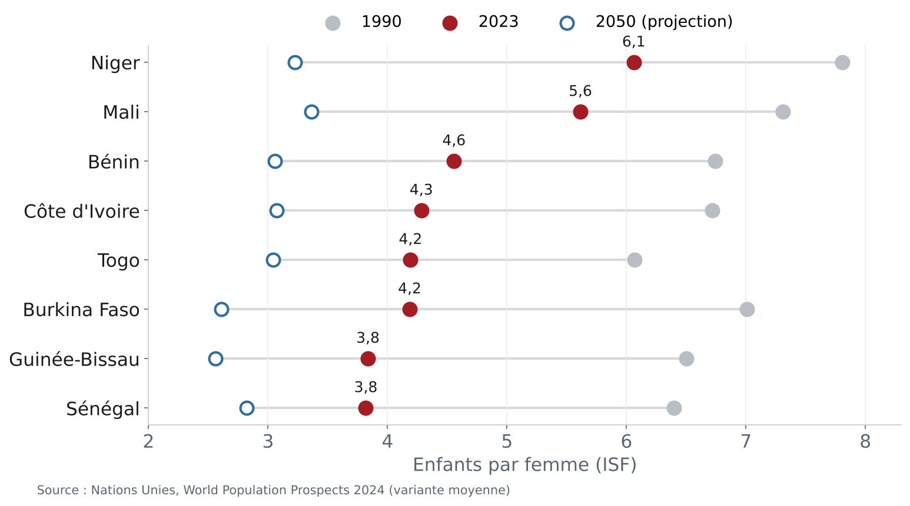
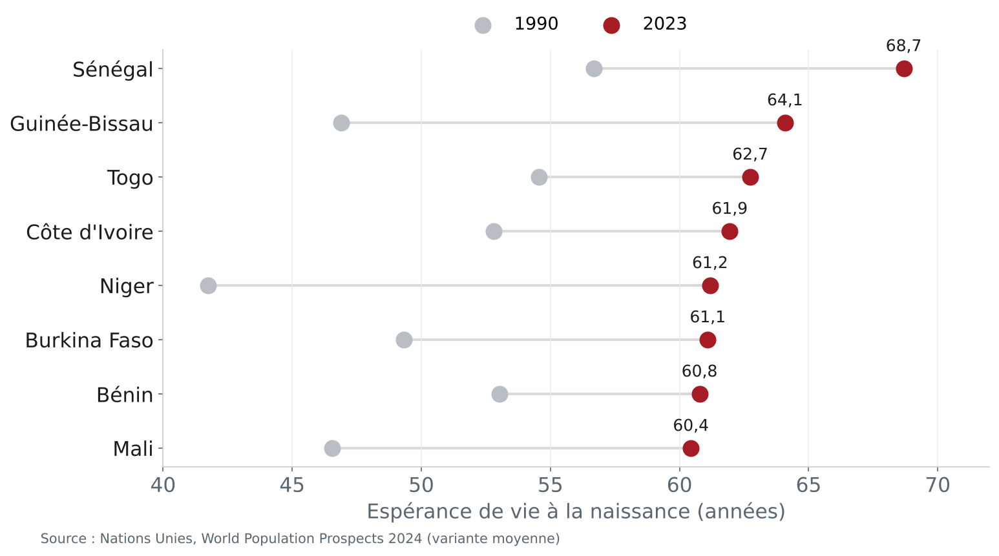
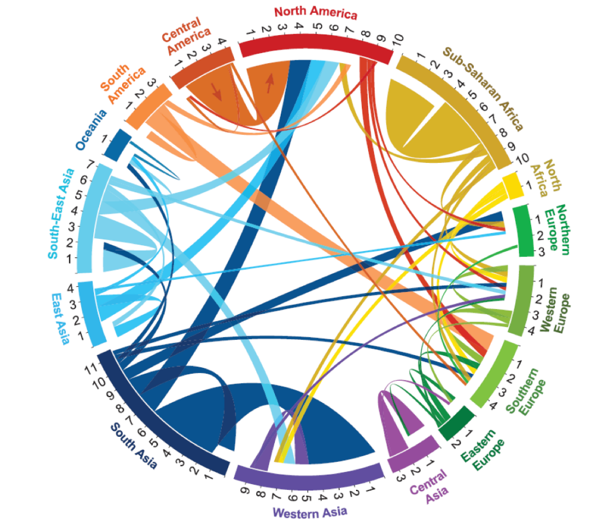
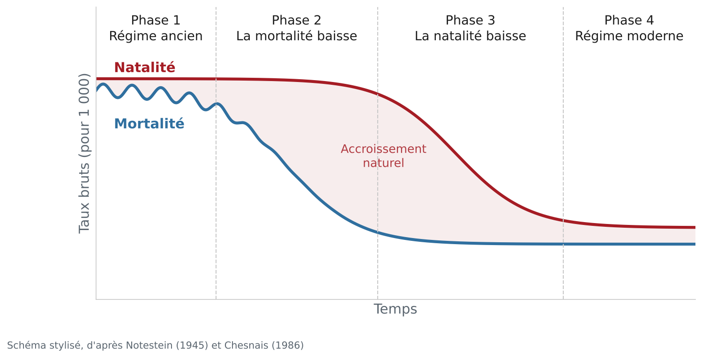
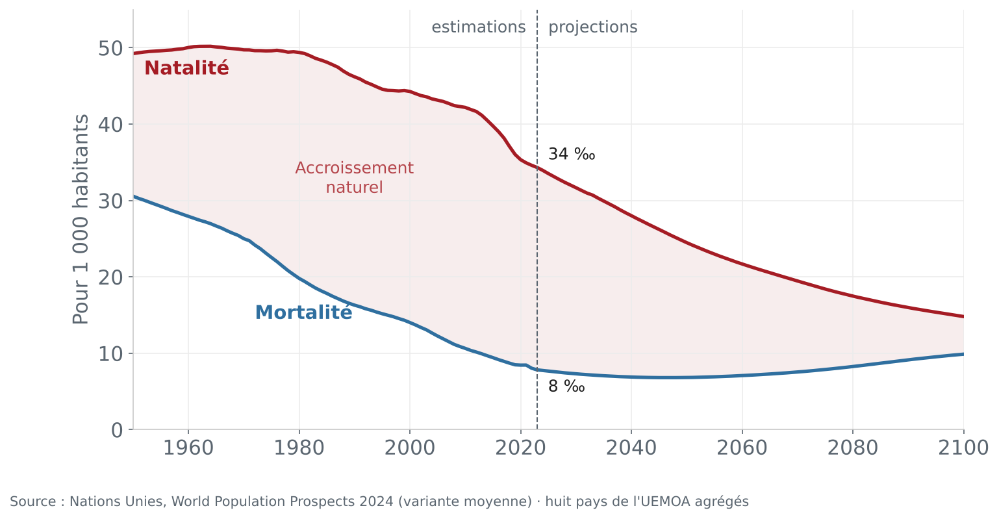
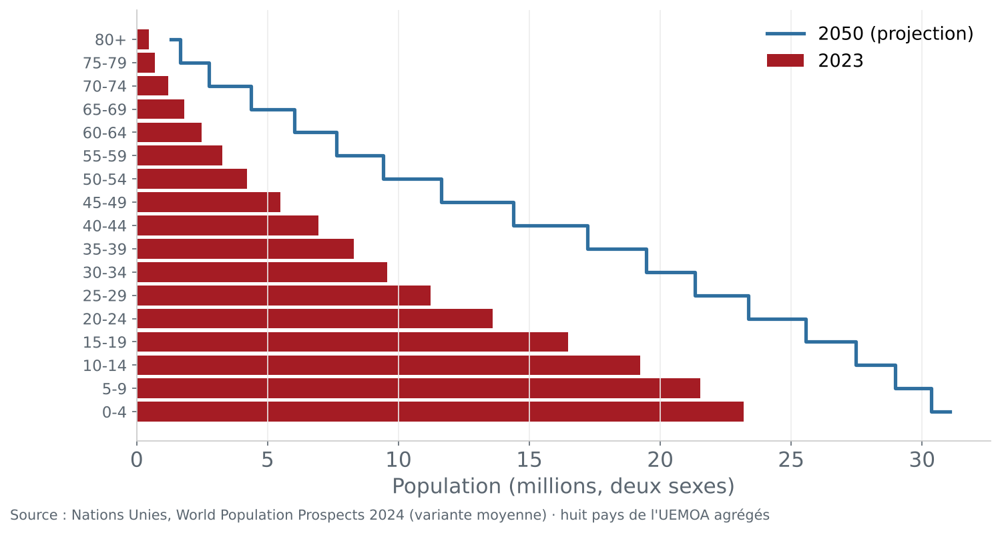
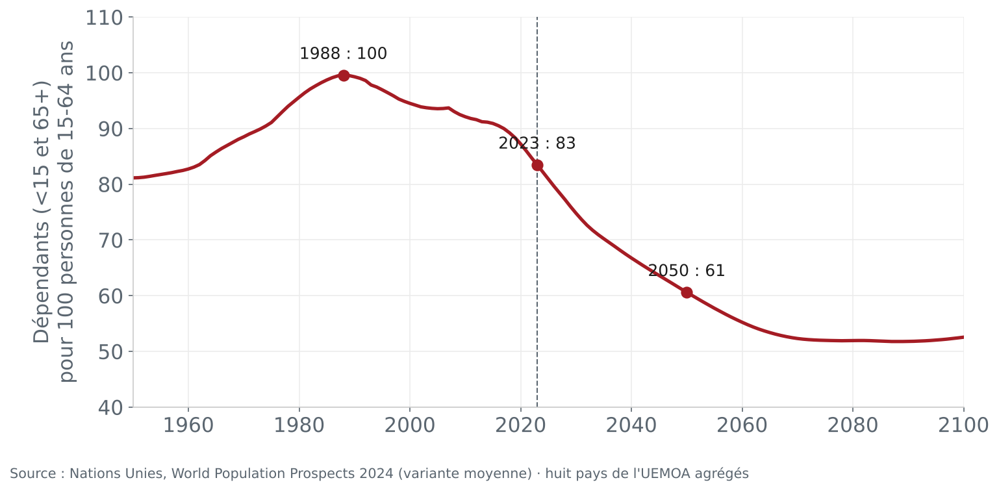
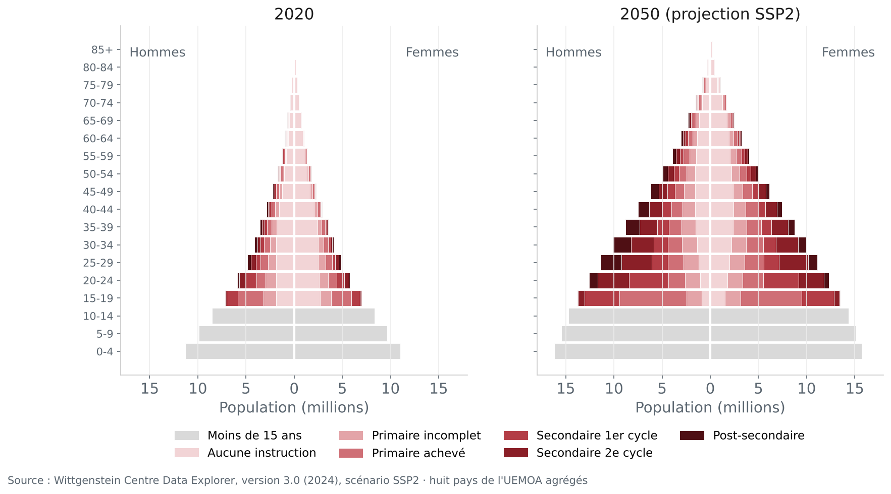

## Déroulé de la matinée

| | Bloc | Durée |
|:--|:--|:--|
| 1 | Présentations | 10 min |
| 2 | Introduction : la semaine et notre façon d'apprendre | 15 min |
| 3 | Que veut dire « mesurer une population » ? | 40 min |
| 4 | Les phénomènes démographiques dans l'UEMOA : mesures et explications | 75 min |
| 5 | La transition démographique et ses conséquences | 60 min |

Pause à 10 h 30. Fin vers 12 h 35.

::: {.notes}
Durée totale : 3 h 15 hors pause. Garder le chronomètre visible : les parties 3 et 5 ont tendance à déborder. La partie 4 passe à 75 minutes pour les théories explicatives de la fécondité, de la mortalité et de la migration, et pour l'effet de structure ; l'introduction est ramenée à 15 minutes.
:::

# 1 · Présentations

## Qui suis-je ? {.smaller}

:::: {.columns}
::: {.column width="50%"}
### Formation
- Doctorat en démographie, U. de Montréal
- Maîtrise en économie du développement, CERDI
- Ingénieur des travaux statistiques, ENSEA
- Mathématiques, Université de Lomé
:::
::: {.column width="50%"}
### Intérêts de recherche
- **Démographie** : familles, fécondité, transition
- **Santé publique** : mortalité des enfants et des mères, santé de la reproduction
- **Méthodes** : causalité, analyse de texte, données massives

### Parcours
- University of Cape Town (2013-2018)
- UQAM depuis 2018, SSAPOPLAB
:::
::::

::: {.notes}
Deux minutes au plus. Insister sur l'ENSEA : une partie de la salle y a sans doute été formée. C'est un point de contact immédiat.
:::

## Tour de table

En une phrase chacun :

- votre nom, votre institut, votre service ;
- **un chiffre de votre pays dont vous doutez**, et pourquoi.

::: {.notes}
Environ 8 minutes pour 30 personnes : 15 secondes chacun. Noter au tableau les chiffres cités : on les reprendra dans les parties 3 et 4.
:::

# 2 · Introduction

## La semaine en un coup d'œil

| Jour | Thème |
|:--|:--|
| Lundi | Fondements : indicateurs et dynamiques démographiques |
| Mardi | Inégalités territoriales et sociales, méthodes avancées |
| Mercredi | Nouvelles sources de données et data science |
| Jeudi | Prospective et scénarios |
| Vendredi | Des analyses aux outils de décision |
| Samedi | Restitutions et feuille de route régionale |

Fil rouge : chaque équipe pays construit **une note d'analyse sur son pays**, section par section, et la présente samedi.

## Chaque journée suit le même déroulé

| Horaire | Bloc |
|:--|:--|
| 8 h 30 – 9 h | Retour sur l'exercice de la veille |
| 9 h – 12 h 30 | Cours |
| 14 h – 15 h 30 | Labo sur données réelles |
| 15 h 45 – 17 h 15 | Travail en équipe pays |
| 17 h 15 – 17 h 30 | Exercice pour le lendemain |

## Quatre révolutions qui marquent notre temps

| Révolution | Ce qu'elle change |
|:--|:--|
| **1. Des données** | *Ce que nous analysons* : volume, vitesse et variété ; des textes, des images, des voix, pas seulement des chiffres |
| **2. Informatique** | *Ce que nous pouvons calculer* : puissance de calcul et stockage qui doublent tous les deux à trois ans, apprentissage automatique |
| **3. De l'apprentissage** | *Comment nous apprenons* : les savoirs vieillissent vite, la capacité d'apprendre devient la compétence clé |
| **4. Des grands modèles de langage** | *Qui fait le travail analytique* : depuis 2022, une machine écrit du code, interprète des résultats et rédige du texte |

::: {.notes}
Pour un institut de statistique, chacune a une traduction concrète : données administratives et numériques (1), traitement de recensements entiers sur un ordinateur portable (2), formation continue des cadres (3), rédaction assistée des rapports (4), que l'on verra vendredi avec l'exemple des rapports DHS.
:::

## Ce que cela change pour apprendre

- **L'agilité d'apprentissage devient la compétence la plus précieuse** (« learning agility is the most competitive ability », Sheila Jagannathan).
- L'ancien goulot d'étranglement, apprendre à taper des commandes, se dissout en partie : **la valeur se déplace vers la formulation, la vérification et la critique**.
- L'IA est un **assistant, jamais un oracle** : elle se trompe avec assurance, invente des références, reproduit les biais de ses données.

> Devise de la semaine : **faire confiance, mais toujours vérifier.**

## Notre philosophie : apprendre à apprendre

L'objectif n'est pas de tout retenir en six jours, mais de **repartir capable d'apprendre seul une méthode nouvelle**.

1. **Se tester plutôt que relire** : exercice du soir, retour du matin.
2. **Apprendre par un problème réel** : la note sur votre pays.
3. **Lire la documentation**, pas seulement le cours.
4. **Enseigner à ses pairs** : c'est vous qui présentez les solutions.
5. **Utiliser l'IA de façon critique**, jamais avec des microdonnées de vos instituts.

## La partie 3 s'appuie sur quatre textes

| Texte | Ce qu'il apporte |
|:--|:--|
| **Preston (1995)**, « Where is US demography headed? » | La démographie comme science de la mesure, utile à l'action publique |
| **Greenhalgh (1996)**, « The social construction of population science » | Mesurer n'est jamais neutre : catégories, institutions, finalités politiques |
| **Tabutin (1997)**, « Les systèmes d'information en démographie » | La démographie dépend de ses sources : recensements, enquêtes, état civil |
| **Cesare et al. (2018)**, « Promises and pitfalls of using digital traces » | Les nouvelles données ne règlent pas ces questions, elles les déplacent |

**Vous n'avez pas à les lire** : je vous en présente l'essentiel. Les parties 4 et 5 s'appuient sur les données de vos pays et sur d'autres références, données au fil des diapositives.

## La question de la matinée

> Que veut dire « mesurer une population » ?
> Et que permet cette mesure quand il faut décider ?

Pour commencer :

> Quand votre institut publie un indice synthétique de fécondité de 4,6, **qu'est-ce qui est réellement mesuré ? Et qu'est-ce qui ne l'est pas ?**

::: {.notes}
Laisser 3 à 4 réponses, sans corriger. Réponses attendues : un indicateur du moment et non une descendance réelle ; une estimation issue d'une enquête par sondage (erreur d'échantillonnage) ; une période de référence (3 ou 5 ans avant l'enquête) ; ce qui n'est pas mesuré : les naissances non déclarées, les intentions, les raisons.
:::

# 3 · Que veut dire mesurer une population ?

## Preston (1995) : une science de la mesure utile à l'action

- La force de la démographie n'est pas la grande théorie, mais **la rigueur de la mesure** : décomposer, comparer, estimer.
- Son orientation vers l'action publique est **une qualité** : elle éclaire les décisions.
- Son avenir : de meilleures données, des méthodes plus fines, des liens avec l'économie, l'épidémiologie, la biologie.

> La démographie progresse en mesurant mieux.

## Greenhalgh (1996) : mesurer n'est jamais neutre

- La démographie s'est construite en lien étroit avec **les États, les fondations et les organisations internationales** qui la financent.
- Ses **catégories** (ménage, chef de ménage, âge, milieu de résidence) sont des constructions, pas des évidences.
- Elle mesure beaucoup, mais **explique peu**, et reste peu ouverte aux théories sociales de son temps : féminismes, postcolonialisme. Nous y reviendrons avec la transition démographique.

> La démographie est une science socialement construite.

## Deux diagnostics, une même discipline

| | Preston | Greenhalgh |
|:--|:--|:--|
| Question posée | Comment rendre la démographie plus performante ? | Quelle est la nature sociale de la démographie ? |
| Statut de la théorie | Secondaire : la rigueur empirique prime | Insuffisant : il manque une théorie sociale |
| Lien avec l'action publique | Une responsabilité | Une dépendance |
| Ce qu'il faut pour avancer | De meilleures données et méthodes | Plus de réflexivité sur les catégories |

Ils ne s'opposent pas sur les faits, mais sur **la finalité** de la discipline.

## Tabutin : la démographie est une science de ses sources

- Toute mesure repose sur un **système d'information** : recensements, état civil, enquêtes par sondage.
- Ces systèmes sont **inégalement développés** : dans la plupart des pays de l'UEMOA, l'état civil reste incomplet, et l'essentiel des indicateurs vient d'enquêtes et de recensements.
- Ce que l'on mesure dépend donc de **ce qui est disponible**, de qui collecte et de qui finance.

> La démographie est autant une science des sources que des idées.

::: {.notes}
Pour des cadres d'INS, c'est le texte le plus proche de leur métier : ils sont les producteurs de ces systèmes d'information. Leur demander : quelle part de vos indicateurs démographiques vient de l'état civil ? d'enquêtes ? du dernier recensement ?
:::

## Un exemple d'actualité

Le programme des **Enquêtes démographiques et de santé (EDS / DHS)** a fourni pendant près de 40 ans une grande partie des indicateurs de fécondité et de mortalité des pays de l'UEMOA.

- Il était financé par l'agence américaine USAID, dont le financement a pris fin en **février 2025**.
- Les données existantes restent accessibles, mais la suite du programme n'est plus garantie.

**Question :** dans votre pays, combien d'indicateurs clés dépendent d'une EDS ? Qui financera la prochaine ?

::: {.notes}
C'est l'argument de Greenhalgh rendu concret : elle notait déjà en 1996 que, depuis les années 1960, l'USAID était devenue l'un des principaux financeurs de la recherche démographique. La dépendance aux bailleurs détermine ce qui sera mesuré demain. Faire le lien avec la feuille de route régionale de samedi.
:::

## Et les nouvelles données ?

**Cesare et al. (2018)** : les traces numériques (réseaux sociaux, téléphonie, données satellitaires) promettent des données plus rapides et moins chères…

…mais elles posent les mêmes questions sous une autre forme : **qui est visible, qui est invisible, qui contrôle les données ?**

Nous y reviendrons **mercredi**.

## Trois lunettes pour la suite de la matinée

> Preston nous montre ce que la démographie sait faire.
> Greenhalgh nous montre ce qu'elle oublie de penser.
> Tabutin nous montre comment elle navigue entre les deux.

Devant chaque chiffre de ce matin, trois questions :

1. **Qu'est-ce qui est mesuré, et qu'est-ce qui ne l'est pas ?**
2. **Qui produit ce chiffre, avec quelle source ?**
3. **Quelle décision ce chiffre permet-il d'éclairer ?**

# 4 · Les phénomènes démographiques dans l'UEMOA : mesurer et expliquer

## L'équation de base

> **Population de demain = population d'aujourd'hui + (naissances − décès) + (immigrants − émigrants)**
>
> (naissances − décès) = accroissement naturel · (immigrants − émigrants) = solde migratoire

- Dans l'UEMOA, la croissance vient presque entièrement de **l'accroissement naturel**.
- Un taux de croissance de 2,5 % par an **double la population en 28 ans** environ.

## L'UEMOA en 2023

| Pays | Population (millions) | ISF | Espérance de vie | Moins de 15 ans (%) | Âge médian |
|:--|--:|--:|--:|--:|--:|
| Bénin | 14,3 | 4,6 | 60,8 | 41,7 | 18 |
| Burkina Faso | 23,3 | 4,2 | 61,1 | 42,1 | 18 |
| Côte d'Ivoire | 31,5 | 4,3 | 61,9 | 41,1 | 19 |
| Guinée-Bissau | 2,2 | 3,8 | 64,1 | 39,0 | 20 |
| Mali | 24,1 | 5,6 | 60,4 | 46,3 | 16 |
| Niger | 26,6 | 6,1 | 61,2 | 46,8 | 16 |
| Sénégal | 18,3 | 3,8 | 68,7 | 38,4 | 20 |
| Togo | 9,4 | 4,2 | 62,7 | 39,7 | 19 |
| *Monde* | *8 127* | *2,3* | *73,2* | *24,9* | *31* |

::: {.smaller}
Source : Nations Unies, *World Population Prospects 2024*. Environ 150 millions d'habitants au total.
:::

## Fécondité : une baisse partout, à des rythmes différents

{fig-align="center" style="max-height: 76vh;"}

::: {.notes}
Lecture : de 1990 à 2023, l'ISF a baissé de 2 à 3 enfants dans la plupart des pays ; le Niger et le Mali restent au-dessus de 5. Les projections 2050 supposent que la baisse se poursuit : c'est une hypothèse, on la discutera jeudi.
:::

## Lunette : quel ISF ?

L'ISF des Nations Unies n'est **pas** celui de votre dernière enquête nationale.

- Les Nations Unies **modélisent** une série continue à partir de toutes les sources disponibles.
- L'enquête donne une estimation pour **une période de référence**, avec une marge d'erreur.

**Exercice (5 min, par pays) :** comparez l'ISF 2023 du tableau avec celui de votre dernière EDS ou MICS. L'écart vous semble-t-il important ? D'où peut-il venir ?

::: {.notes}
Réponses attendues : année de référence différente, ajustements des Nations Unies (sous-déclaration, déplacement des naissances), erreur d'échantillonnage. Message : un chiffre n'existe pas sans sa source. C'est Tabutin.
:::

## Expliquer la fécondité

**Déterminants proches** (Davis et Blake, 1956 ; Bongaarts, 1978) : la fécondité ne change **que** par quatre canaux.

| Canal | Au Sahel |
|:--|:--|
| L'**union** (âge au mariage, célibat, rupture) | Mariage précoce des filles |
| La **contraception** | Faible prévalence, besoins non satisfaits |
| L'**avortement** provoqué | Mal mesuré, souvent clandestin |
| L'**infécondabilité post-partum** (allaitement, abstinence) | Longue : principal frein à la fécondité |

**Causes profondes**, qui passent par ces canaux : théories de la partie 5, **diffusion** des normes (Cleland et Wilson, 1987), **ralentissements** de la baisse en Afrique (Bongaarts, 2006 ; Schoumaker, 2019).

::: {.notes}
Le cadre des déterminants proches est l'outil de travail des INS : chaque canal correspond à un module des EDS (nuptialité, contraception, allaitement). Les ralentissements : la baisse de la fécondité a marqué le pas dans plusieurs pays d'Afrique de l'Ouest ; Schoumaker (2019) les relie en partie aux perturbations de la scolarisation des femmes. Lunette critique : Caldwell et Caldwell (1987) expliquaient la forte fécondité africaine par la religion des lignages et des ancêtres ; c'est l'exemple type d'une explication « culturelle » que la perspective décoloniale invite à discuter.
:::

## Mortalité : des gains considérables

{fig-align="center" style="max-height: 76vh;"}

::: {.notes}
Lecture : le Niger a gagné près de 20 ans d'espérance de vie depuis 1990 (41,7 à 61,2 ans). Le Sénégal est à près de 69 ans. Le recul de la mortalité des enfants explique l'essentiel de ces gains.
:::

## Lunette : une mortalité surtout estimée

Sans état civil complet, la mortalité n'est pas **observée**, elle est **estimée** :

- à partir des historiques de naissances des enquêtes (mortalité des enfants) ;
- à partir de tables-types et de méthodes indirectes (mortalité des adultes) ;
- avec des modèles pour combler les années sans données.

Plus l'âge est élevé, plus l'estimation est fragile. **Ce que l'on sait le moins bien, c'est la mortalité des adultes.**

::: {.notes}
Lien avec le labo de cet après-midi et avec le manuel « Outils d'estimation démographique » de l'UIESP, en français et gratuit.
:::

## Expliquer la baisse de la mortalité

| Explication | Ce qui fait baisser la mortalité |
|:--|:--|
| **McKeown (1976)** | Le niveau de vie et la nutrition, plus que la médecine |
| **Szreter (1988)** | L'action publique : eau potable, assainissement, hygiène |
| **Preston (1975)** | À revenu égal, l'espérance de vie progresse : la santé publique compte plus que le revenu |
| **Caldwell (1986)** | Sri Lanka, Kerala, Costa Rica : faible mortalité grâce à l'**instruction des femmes** et à la **volonté politique** |
| **Mosley et Chen (1984)** | Enfants : les facteurs sociaux passent par des **déterminants proches** (nutrition, environnement, soins…) |

**UEMOA** : vaccination, lutte contre le paludisme, instruction des mères, bien plus que croissance des revenus.

::: {.notes}
Le débat McKeown-Szreter n'est pas académique : il oppose « attendre la croissance » à « investir dans la santé publique ». Le cadre de Mosley et Chen est la base de la plupart des analyses de la mortalité des enfants à partir des EDS. Caldwell (1986) est la référence la plus utile pour les décideurs : la faible mortalité est d'abord un choix politique.
:::

## Après la baisse : la transition sanitaire

- **Omran (1971)** : des pestilences et famines aux maladies dégénératives.
- **Olshansky et Ault (1986)** : un 4e âge, où les maladies chroniques sont retardées.
- **Frenk et al. (1989)** : au Sud, les âges se **chevauchent** au lieu de se succéder.
- **Vallin et Meslé (2004)** : la **transition sanitaire** alterne divergences et convergences entre pays.

**UEMOA** : un **double fardeau**. Infections et mortalité maternelle et infantile restent fortes ; hypertension, diabète et cancers progressent.

::: {.notes}
Vallin et Meslé, en français, sont une bonne porte d'entrée : chaque grande innovation (antibiotiques, révolution cardiovasculaire) creuse d'abord des écarts entre pays avant de converger. Question à la salle : votre système de santé et votre système statistique sont-ils organisés pour suivre les maladies chroniques ?
:::

## Attention : un taux brut mélange deux choses

Taux brut de mortalité en 2023 : **Sénégal 5,6 ‰** · **Burkina Faso 8,0 ‰**

Un taux brut combine :

- les **risques par âge** : la probabilité de mourir, ou d'avoir un enfant, à chaque âge ;
- la **structure par âge** : le poids de chaque âge dans la population.

> TBM = Σ (part de la population à l'âge x) × (taux de mortalité à l'âge x)

Une population jeune a peu de décès, même si les risques y sont élevés. **Comparer des taux bruts, c'est comparer en partie des pyramides.**

::: {.notes}
Analogie : comparer la mortalité d'une école primaire et d'une maison de retraite. Le TBM de la maison de retraite est bien plus élevé, même si on y soigne mieux. Transition vers les deux outils : standardiser et décomposer.
:::

## Standardiser : comparer à structure égale

| | Principe | Résultat |
|:--|:--|:--|
| **Directe** | On applique les taux par âge de chaque pays à une **même** structure par âge | Le TBM qu'aurait le pays avec la structure de l'UEMOA |
| **Indirecte** | On applique des taux de référence à la population du pays | Indice comparatif : décès observés / décès attendus |

Exemple, avec la structure par âge de l'UEMOA comme référence :

| Pays | TBM brut | TBM standardisé (structure UEMOA) | Indice comparatif |
|:--|--:|--:|--:|
| Sénégal | 5,6 ‰ | **5,0 ‰** | 0,67 |
| Burkina Faso | 8,0 ‰ | **8,3 ‰** | 1,05 |

Le Sénégal est plus avantagé qu'il n'y paraît ; le Burkina Faso, moins.

::: {.notes}
Le Sénégal a une population un peu plus âgée, ce qui gonfle son TBM brut. Le Burkina Faso a une structure jeune qui masquait une mortalité supérieure à celle de l'Union. La standardisation indirecte sert quand on ne connaît que le total des décès d'une région, pas leur répartition par âge : situation fréquente avec un état civil incomplet. Source : calculs sur le WPP 2024, refaits au labo.
:::

## Décomposer : d'où vient un écart ?

Le Niger a un taux brut de natalité supérieur de **7,3 points** à celui de l'UEMOA. La méthode de Kitagawa (1955) partage cet écart :

| Composante | Niger, en points de ‰ |
|:--|--:|
| Effet de la **fécondité** (taux par âge plus élevés) | +9,7 |
| Effet de la **structure** (part des femmes de 15 à 49 ans) | −2,5 |
| **Écart total** | **+7,3** |

La très forte proportion d'enfants **masque** une partie de la fécondité. Quand ces enfants auront 15 ans, la natalité restera forte même si la fécondité baisse : c'est l'**inertie démographique**.

::: {.notes}
Annoncer le jeudi : l'inertie démographique (Keyfitz, 1971) explique pourquoi la population de l'UEMOA continuera de croître longtemps après la baisse de la fécondité. Pour décomposer à partir de microdonnées (urbain et rural, par exemple), on utilise Blinder-Oaxaca.
:::

## Lunette : ce que ces outils ne disent pas

- **Standardiser, c'est choisir une norme.** Avec la population type mondiale de l'OMS, plus âgée, les chiffres changent. Qui choisit la référence, et à quoi compare-t-on l'Afrique ?
- **Une décomposition est une comptabilité, pas une explication.** Elle dit *combien* de l'écart vient de la fécondité, pas *pourquoi* la fécondité diffère.
- Pour le *pourquoi*, il faut une **théorie** : Coale, Caldwell, Becker, et les perspectives critiques de la partie 5.

::: {.notes}
C'est le pont entre la partie « phénomènes » et la partie « théories ». Message pour l'après-midi : les participants savent calculer ; la valeur ajoutée de la formation est dans l'interprétation.
:::

## Migration : un solde proche de zéro ne veut pas dire peu de mobilité

Solde migratoire net en 2023, pour 1 000 habitants : **Mali −1,7 · Burkina Faso −1,1 · Guinée-Bissau −0,7 · Sénégal −0,6 · Togo −0,2 · Bénin 0,0 · Niger 0,0 · Côte d'Ivoire +0,2**

- Un solde **net** additionne des entrées et des sorties qui peuvent être importantes.
- La mobilité entre pays de l'UEMOA, la migration saisonnière et la mobilité interne **n'apparaissent pas** dans ce chiffre.
- C'est la composante la plus mal mesurée de l'équation.

::: {.notes}
Source : WPP 2024. Question : votre dernier recensement permet-il de mesurer les entrées et les sorties, ou seulement la population née à l'étranger ?
:::

## Expliquer la migration

| Approche | Pourquoi part-on ? |
|:--|:--|
| **Ravenstein (1885) ; Lee (1966)** | Des facteurs d'**attraction** et de **répulsion**, et des obstacles intermédiaires |
| **Néoclassique** (Todaro, 1969 ; Harris et Todaro, 1970) | Un calcul individuel : l'écart de revenu **espéré** entre le village et la ville, ou entre deux pays |
| **Nouvelle économie de la migration** (Stark et Bloom, 1985) | Une stratégie du **ménage** pour diversifier ses risques ; les **transferts** en sont la contrepartie |
| **Marché du travail segmenté** (Piore, 1979) | La demande d'emplois peu qualifiés dans les pays d'accueil |
| **Réseaux** (Massey et al., 1993) | Les migrants déjà installés réduisent le coût du départ : la migration s'entretient elle-même |
| **Aspirations et capacités** (de Haas, 2010, 2021) | Il faut **vouloir** et **pouvoir** partir : le développement augmente d'abord la migration |

::: {.notes}
Massey et al. (1993) est la synthèse de référence. Le point de de Haas est contre-intuitif pour les décideurs : ce ne sont pas les plus pauvres qui émigrent le plus loin, car partir coûte cher ; le développement accroît d'abord les capacités, donc la migration (la « bosse migratoire »). Zelinsky (1971) proposait déjà une « transition de la mobilité » parallèle à la transition démographique.
:::

## Une migration Sud-Sud sous-estimée {.smaller}

:::: {.columns}
::: {.column width="45%"}
{width="100%"}

[Source : Migration Data Portal]{style="font-size:0.7em"}
:::
::: {.column width="55%"}
- La migration africaine va **surtout vers d'autres pays africains**, contrairement à la rhétorique dominante.
- L'Afrique subsaharienne a l'une des plus fortes parts de migration **intrarégionale** du Sud global (Schewel et Debray, 2024).
- En 2020, **63 %** des 28,3 millions de migrants d'Afrique subsaharienne vivaient dans un autre pays de la région : **Côte d'Ivoire**, Afrique du Sud, Ouganda en tête.
- La sous-estimation vient en partie de la **collecte** :
  - **stocks** : fiables et disponibles, mais ils sous-estiment la mobilité ;
  - **flux** : plus difficiles à collecter.
:::
::::

::: {.notes}
Diapositive préparée par Yentéma Onadja et Alexandra Tapsoba. Chiffres de 2020 : UN DESA, repris par Schewel et Debray (2024). Question à la salle : votre institut publie-t-il des stocks de migrants, des flux, ou les deux ? Le recensement donne des stocks (lieu de naissance, résidence antérieure) ; les flux demandent des registres, des enquêtes répétées ou des données de passage aux frontières.
:::

## La migration dans l'UEMOA

- **La plupart des migrants ouest-africains restent dans la région** (Flahaux et de Haas, 2016) : couloir Burkina Faso–Côte d'Ivoire.
- La **libre circulation** CEDEAO facilite ces mouvements et les rend **moins visibles** dans les statistiques.
- **Réseaux** et **stratégies familiales** les expliquent mieux que l'écart de revenu.
- Les crises au Sahel créent des **déplacements forcés internes**, que ces théories expliquent mal.

**Lunette** : la « crise migratoire » vise surtout les départs vers l'Europe, minoritaires. Qui définit le problème ?

## Urbanisation : une catégorie à définir

Qu'est-ce qu'une « ville » ? La réponse **change d'un pays à l'autre** :

- un seuil de population (2 000, 5 000, 10 000 habitants…) ;
- un statut administratif (chef-lieu, commune urbaine) ;
- des critères d'équipement ou d'activité.

**Question à la salle :** quelle définition votre dernier recensement utilise-t-il ?

Conséquence : comparer les taux d'urbanisation des huit pays suppose d'abord **d'harmoniser la définition**. C'est l'argument de Greenhalgh, et un sujet pour samedi.

# 5 · La transition démographique et ses conséquences

## Une théorie née de l'histoire européenne

- **Thompson (1929)** repère des régularités : des pays où mortalité et fécondité baissent, d'autres où seule une partie de la société est concernée, d'autres encore où rien n'a bougé.
- **Notestein (1945)** en fait une théorie : un **modèle spatio-temporel** qui décrit le passage d'une population à natalité et mortalité élevées à une population où elles sont faibles.
- **Hypothèse de base** : toutes les populations du monde suivront le même chemin, avec des décalages de calendrier.

::: {.notes}
Ordre de grandeur : la population mondiale passe d'un milliard en 1800 à six milliards en 2000. C'est la transition qui produit cette croissance inédite.
:::

## Le schéma de la transition

{fig-align="center" style="max-height: 76vh;"}

## Les quatre phases

| Phase | Mortalité | Natalité | Accroissement naturel |
|:--|:--|:--|:--|
| **1. Régime ancien** | Élevée, avec des crises | Élevée (normes, religion, mariage) | Faible |
| **2. Baisse de la mortalité** | Baisse rapide | Reste élevée | Fort, croissant |
| **3. Baisse de la natalité** | Baisse plus lente | Baisse | Fort, puis en baisse |
| **4. Régime moderne** | Faible et stable | Faible, fluctuante | Faible, voire négatif |

Europe : de 1740 à 1940 environ. Pays du Sud : **plus rapide**, dans des conditions économiques plus précaires.

::: {.notes}
Au régime ancien, c'est la mortalité qui régule la population ; au régime moderne, c'est la natalité. La transition épidémiologique d'Omran (1971) décrit le versant « mortalité » : l'âge des pestilences et des famines, l'âge du recul des pandémies, puis l'âge des maladies dégénératives et de société.
:::

## Pourquoi la fécondité baisse-t-elle ?

| Explication | Mécanisme principal |
|:--|:--|
| **Notestein (1945)** | Mortalité en baisse, urbanisation, modernisation : les familles nombreuses deviennent coûteuses |
| **Davis (1963)** | **Réponses multiples** : mariage retardé, célibat, contraception, avortement, migration |
| **Coale (1973)** | Trois conditions : **choix conscient**, **intérêt** à limiter, **moyens** disponibles |
| **Caldwell (1976)** | Les **flux de richesses** entre générations s'inversent |
| **Becker (1991)** | Arbitrage entre le **nombre** et la **« qualité »** des enfants |

**Limite commune** : un fait stylisé, pas une explication. D'où le pluriel de Mason (1997) : *des* transitions.

## Trois perspectives critiques

| Perspective | Ce qu'elle examine | Question qu'elle pose à la démographie |
|:--|:--|:--|
| **Antiraciste** | Comment les catégories raciales et ethniques sont construites, et comment elles produisent ou légitiment des hiérarchies entre groupes | Nos catégories et nos explications « culturelles » de la fécondité naturalisent-elles des différences entre groupes ? |
| **Féministe** | Les rapports de pouvoir entre les sexes : division du travail, contrôle de la sexualité et de la reproduction | Qui décide de la fécondité ? Que mesure-t-on des hommes, de la contrainte, de la violence ? |
| **Décoloniale** | La « colonialité du savoir » : les normes, les catégories et les agendas définis au Nord et présentés comme universels | Qui définit ce qu'est une population « en retard », et au nom de quel modèle ? |

## La transition peut-elle être réconciliée avec ces perspectives ? {.smaller}

:::: {.columns}
::: {.column width="33%"}
### Eurocentrisme
La théorie est construite sur les trajectoires européennes. Les autres régions sont pensées comme **« en retard »** ou **« en transition incomplète »**.

L'histoire européenne devient la norme universelle.
:::
::: {.column width="33%"}
### Angle mort féministe
La fécondité est traitée comme un comportement agrégé, une réponse « rationnelle » aux contraintes.

Où sont les **rapports de genre**, le pouvoir reproductif, la contrainte, l'accès inégal à la contraception ?
:::
::: {.column width="33%"}
### Critique décoloniale
La transition est liée historiquement aux politiques coloniales, aux **politiques de population** et aux interventions internationales sur la reproduction.

La fécondité n'est pas qu'un choix : **elle est aussi gouvernée**.
:::
::::

::: {.notes}
Greenhalgh (1996) rappelle qu'après 1945 la théorie de la transition a servi à justifier des programmes de planification familiale financés par des fondations (Ford, Rockefeller), puis par l'aide américaine. Laisser 10 minutes de discussion.
:::

## Et dans nos systèmes statistiques ?

- **Chef de ménage** : qui le désigne ? Que devient l'autorité des femmes dans le ménage quand on n'enregistre qu'une personne ?
- **Fécondité des hommes** : presque toutes nos mesures portent sur les femmes. Que sait-on de la fécondité et des intentions des hommes ?
- **Ethnie** : faut-il la collecter ? Pour quels usages, et avec quels risques ?
- **Questionnaires et indicateurs** : qui les conçoit ? Qui les finance ? Qui choisit les priorités ?

**Discussion (10 min) :** une réconciliation est-elle possible ? Que faudrait-il changer, concrètement, dans la façon dont votre institut mesure la population ?

::: {.notes}
Pistes de réponse : intégrer des modules sur l'autonomie et la prise de décision des femmes (déjà présents dans les EDS), mesurer la fécondité des hommes, associer les INS à la conception des questionnaires régionaux, croiser enquêtes quantitatives et approches qualitatives (démographie anthropologique, Greenhalgh 1995). La réconciliation passe moins par l'abandon de la théorie que par l'élargissement de ce que l'on mesure.
:::

## Quatre modèles de transition en Afrique {.smaller}

D'après **Tabutin et Schoumaker (2004)** :

1. **Le modèle encore traditionnel** : la mortalité a reculé, la natalité reste très élevée (Mali, Niger, Burkina Faso au début des années 2000).
2. **Le modèle classique** : la mortalité baisse depuis 50 ans, la natalité depuis 20 ans (Sénégal, Ghana).
3. **Le modèle perturbé par les guerres** : reprises brutales de la mortalité (Sierra Leone, RD Congo, Rwanda).
4. **Le modèle perturbé par le sida** : la mortalité remonte après 1990 (Afrique australe, Côte d'Ivoire, Cameroun).

**Question :** vingt ans plus tard, dans quel modèle placeriez-vous votre pays ?

## La transition dans l'UEMOA

{fig-align="center" style="max-height: 76vh;"}

::: {.notes}
Lecture : la mortalité baisse depuis les années 1950 (31 ‰ à 8 ‰), la natalité seulement depuis les années 1980 (49 ‰ à 34 ‰). L'écart entre les deux courbes, environ 26 ‰ aujourd'hui, est l'accroissement naturel. L'UEMOA est dans la phase 3.
:::

## Une structure par âge très jeune, qui va vieillir

{fig-align="center" style="max-height: 76vh;"}

::: {.notes}
Lecture : en 2023, plus de 4 habitants sur 10 ont moins de 15 ans. En 2050, toutes les classes d'âge augmentent, mais surtout les adultes : la pyramide s'élargit au milieu.
:::

## Le rapport de dépendance a commencé à baisser

{fig-align="center" style="max-height: 76vh;"}

::: {.notes}
Lecture : il y avait 100 personnes à charge pour 100 adultes en 1988, 83 en 2023, 61 en 2050 selon la projection. C'est la « fenêtre d'opportunité » démographique.
:::

## Le dividende démographique

Quand la part des **personnes en âge de travailler** augmente, l'économie peut croître plus vite (Bloom, Canning et Sevilla, 2003), **à condition que** :

- ces adultes trouvent un **emploi** productif ;
- ils aient été **éduqués** et soient **en bonne santé** ;
- l'épargne dégagée soit **investie**.

> Le dividende n'est pas automatique : c'est une opportunité, pas une garantie. Les institutions publiques y jouent un rôle décisif.

::: {.notes}
Bloom et ses coauteurs : « governments invariably play a vital role in creating an environment where high-quality health and education provision is possible ». Comparaison classique : l'Asie de l'Est a saisi le dividende, l'Amérique latine beaucoup moins.
:::

## Un dividende d'âge… ou d'éducation ?

{fig-align="center" style="max-height: 80vh;"}

## Ce que montrent ces pyramides

- En 2020, près de **la moitié des 25-34 ans** de l'UEMOA n'a **aucune instruction** (49 %), et **21 %** ont atteint au moins le secondaire.
- En 2050, selon le scénario intermédiaire, ils seraient **16 %** sans instruction et **54 %** au moins au secondaire.
- L'écart entre les sexes reste net : chez les 25-34 ans, **16 % des femmes** contre 27 % des hommes ont atteint le secondaire en 2020.

Pour **Lutz et al. (2019)**, c'est l'**éducation**, plus que la structure par âge, qui produit le dividende. Un pays qui gagne des adultes sans les scolariser n'en tirera qu'un faible bénéfice.

::: {.smaller}
Source : Wittgenstein Centre Data Explorer, version 3.0 (2024), scénario SSP2, huit pays agrégés.
:::

## Ce que cela représente pour l'UEMOA, d'ici 2050

| | 2023 | 2050 | Écart |
|:--|--:|--:|--:|
| Population totale | 150 M | 268 M | +118 M (+79 %) |
| Enfants d'âge scolaire (6-16 ans) | 43 M | 63 M | +19 M (+45 %) |
| Population de 15-64 ans | 82 M | 167 M | +85 M |
| Population de 65 ans et plus | 4,2 M | 12,1 M | multipliée par 2,9 |

::: {.smaller}
Source : *World Population Prospects 2024*, variante moyenne, huit pays agrégés.
:::

## Les conséquences par secteur

- **Éducation** : 19 millions d'élèves potentiels de plus, donc des écoles et des enseignants à prévoir dès maintenant.
- **Emploi** : environ **3 millions** de personnes de plus en âge de travailler **chaque année**.
- **Santé** : un double fardeau, avec la santé maternelle et infantile d'un côté, la hausse des maladies chroniques liée au vieillissement de l'autre.

**Lunette** : ces chiffres reposent sur des **hypothèses** (une fécondité d'environ 3 enfants par femme en 2050). Changer l'hypothèse change les besoins : c'est le sujet de jeudi.

## À retenir

1. **Mesurer une population n'est jamais neutre** : catégories, institutions, finalités.
2. **La démographie dépend de ses sources** : ce que l'on mesure dépend de ce qui est disponible, et de qui finance.
3. **La transition démographique décrit bien, mais explique mal** ; elle gagne à être lue avec les perspectives féministe, antiraciste et décoloniale.
4. **L'UEMOA est en pleine transition**, et la fenêtre du dividende s'ouvre. Elle ne profitera qu'aux pays qui investissent dans **l'éducation**, la santé et l'emploi.

## Avant de partir : une minute

Sur un papier, sans nom :

1. **Ce que j'ai appris ce matin**, en une phrase.
2. **Ce qui reste flou pour moi**, en une phrase.

::: {.notes}
Ramasser les papiers. Lire les réponses ce soir : elles servent à ouvrir le retour du mardi matin.
:::

## Cet après-midi

- **Labo** : les calculs de ce matin (ISF, table de mortalité, pyramide, standardisation, décomposition) sont fournis en R et en Excel. Le temps est consacré à **interpréter** les résultats avec les théories du cours, et à **questionner** les sources et les catégories.
- **Équipe pays** : le profil démographique de votre pays en cinq indicateurs, situé dans la transition, première section de la note pays.
- **16 h 30** : séminaire en ligne de Laurent Martel, Statistique Canada.
- **Exercice pour demain** : comparer votre pays à l'ensemble de l'UEMOA sur trois indicateurs et proposer une explication.

## Références : mesurer une population {.smaller .scrollable}

- Cesare, N., Lee, H., McCormick, T., Spiro, E. et Zagheni, E. (2018). Promises and pitfalls of using digital traces for demographic research. *Demography*, 55(5), 1979-1999.
- Greenhalgh, S. (1996). The social construction of population science: An intellectual, institutional, and political history of twentieth-century demography. *Comparative Studies in Society and History*, 38(1), 26-66.
- Preston, S. H. (1995). Where is US demography headed? Dans J.-C. Chasteland et L. Roussel (dir.), *Les contours de la démographie au seuil du XXIe siècle* (p. 233-250). INED.
- Tabutin, D. (1997). Les systèmes d'information en démographie. Dans G. Caselli, J. Vallin et G. Wunsch (dir.), *Démographie : analyse et synthèse*. CEPED.
- Tabutin, D. (2007). Vers quelle(s) démographie(s) ? Atouts, faiblesses et évolutions de la discipline depuis 50 ans. *Population*, 62(1), 15-32.

## Références : expliquer la fécondité, la mortalité et la migration {.smaller .scrollable}

*Fécondité*

- Bongaarts, J. (1978). A framework for analyzing the proximate determinants of fertility. *Population and Development Review*, 4(1), 105-132.
- Bongaarts, J. (2006). The causes of stalling fertility transitions. *Studies in Family Planning*, 37(1), 1-16.
- Caldwell, J. C. et Caldwell, P. (1987). The cultural context of high fertility in sub-Saharan Africa. *Population and Development Review*, 13(3), 409-437.
- Cleland, J. et Wilson, C. (1987). Demand theories of the fertility transition: An iconoclastic view. *Population Studies*, 41(1), 5-30.
- Davis, K. et Blake, J. (1956). Social structure and fertility: An analytic framework. *Economic Development and Cultural Change*, 4(3), 211-235.
- Schoumaker, B. (2019). Stalls in fertility transitions in sub-Saharan Africa: Revisiting the evidence. *Studies in Family Planning*, 50(3), 257-278.

*Mortalité*

- Caldwell, J. C. (1986). Routes to low mortality in poor countries. *Population and Development Review*, 12(2), 171-220.
- Frenk, J., Bobadilla, J. L., Sepúlveda, J. et López Cervantes, M. (1989). Health transition in middle-income countries: New challenges for health care. *Health Policy and Planning*, 4(1), 29-39.
- McKeown, T. (1976). *The Modern Rise of Population*. Edward Arnold.
- Mosley, W. H. et Chen, L. C. (1984). An analytical framework for the study of child survival in developing countries. *Population and Development Review*, 10 (supplément), 25-45.
- Olshansky, S. J. et Ault, A. B. (1986). The fourth stage of the epidemiologic transition: The age of delayed degenerative diseases. *Milbank Quarterly*, 64(3), 355-391.
- Preston, S. H. (1975). The changing relation between mortality and level of economic development. *Population Studies*, 29(2), 231-248.
- Szreter, S. (1988). The importance of social intervention in Britain's mortality decline c.1850-1914: A re-interpretation of the role of public health. *Social History of Medicine*, 1(1), 1-37.
- Vallin, J. et Meslé, F. (2004). Convergences and divergences in mortality: A new approach to health transition. *Demographic Research*, Special Collection 2, 11-44.

*Migration*

- de Haas, H. (2010). Migration and development: A theoretical perspective. *International Migration Review*, 44(1), 227-264.
- de Haas, H. (2021). A theory of migration: The aspirations-capabilities framework. *Comparative Migration Studies*, 9, 8.
- Flahaux, M.-L. et de Haas, H. (2016). African migration: Trends, patterns, drivers. *Comparative Migration Studies*, 4, 1.
- Harris, J. R. et Todaro, M. P. (1970). Migration, unemployment and development: A two-sector analysis. *American Economic Review*, 60(1), 126-142.
- Lee, E. S. (1966). A theory of migration. *Demography*, 3(1), 47-57.
- Massey, D. S., Arango, J., Hugo, G., Kouaouci, A., Pellegrino, A. et Taylor, J. E. (1993). Theories of international migration: A review and appraisal. *Population and Development Review*, 19(3), 431-466.
- Piore, M. J. (1979). *Birds of Passage: Migrant Labor and Industrial Societies*. Cambridge University Press.
- Ravenstein, E. G. (1885). The laws of migration. *Journal of the Statistical Society of London*, 48(2), 167-235.
- Schewel, K. et Debray, A. (2024). Global trends in South–South migration. Dans H. Crawley et J. K. Teye (dir.), *The Palgrave Handbook of South–South Migration and Inequality*. Palgrave Macmillan. https://doi.org/10.1007/978-3-031-39814-8_8
- Stark, O. et Bloom, D. E. (1985). The new economics of labor migration. *American Economic Review*, 75(2), 173-178.
- Todaro, M. P. (1969). A model of labor migration and urban unemployment in less developed countries. *American Economic Review*, 59(1), 138-148.
- Zelinsky, W. (1971). The hypothesis of the mobility transition. *Geographical Review*, 61(2), 219-249.

## Références : transition démographique {.smaller .scrollable}

- Becker, G. S. (1991). *A Treatise on the Family* (éd. augmentée). Harvard University Press.
- Caldwell, J. C. (1976). Toward a restatement of demographic transition theory. *Population and Development Review*, 2(3-4), 321-366.
- Caldwell, J. C. (2004). Demographic theory: A long view. *Population and Development Review*, 30(2), 297-316.
- Chesnais, J.-C. (1986). *La transition démographique : étapes, formes, implications économiques*. INED et PUF.
- Coale, A. J. (1973). The demographic transition reconsidered. *International Population Conference, Liège*, vol. 1, 53-72. UIESP.
- Coale, A. J. et Watkins, S. C. (dir.) (1986). *The Decline of Fertility in Europe*. Princeton University Press.
- Davis, K. (1963). The theory of change and response in modern demographic history. *Population Index*, 29(4), 345-366.
- Keyfitz, N. (1971). On the momentum of population growth. *Demography*, 8(1), 71-80.
- Kirk, D. (1996). Demographic transition theory. *Population Studies*, 50(3), 361-387.
- Kitagawa, E. M. (1955). Components of a difference between two rates. *Journal of the American Statistical Association*, 50(272), 1168-1194.
- Lee, R. (2003). The demographic transition: Three centuries of fundamental change. *Journal of Economic Perspectives*, 17(4), 167-190.
- Mason, K. O. (1997). Explaining fertility transitions. *Demography*, 34(4), 443-454.
- Notestein, F. W. (1945). Population: The long view. Dans T. W. Schultz (dir.), *Food for the World* (p. 36-57). University of Chicago Press.
- Omran, A. R. (1971). The epidemiologic transition: A theory of the epidemiology of population change. *Milbank Memorial Fund Quarterly*, 49(4), 509-538.
- Tabutin, D. et Schoumaker, B. (2004). La démographie de l'Afrique au sud du Sahara des années 1950 aux années 2000. *Population*, 59(3-4), 521-622.
- Thompson, W. S. (1929). Population. *American Journal of Sociology*, 34(6), 959-975.

## Références : perspectives critiques et dividende {.smaller .scrollable}

**Perspectives critiques**

- Connelly, M. (2008). *Fatal Misconception: The Struggle to Control World Population*. Harvard University Press.
- Greenhalgh, S. (dir.) (1995). *Situating Fertility: Anthropology and Demographic Inquiry*. Cambridge University Press.
- Riley, N. E. et McCarthy, J. (2003). *Demography in the Age of the Postmodern*. Cambridge University Press.

**Dividende démographique**

- Bloom, D. E., Canning, D. et Sevilla, J. (2003). *The Demographic Dividend: A New Perspective on the Economic Consequences of Population Change*. RAND.
- Canning, D., Raja, S. et Yazbeck, A. S. (dir.) (2015). *Africa's Demographic Transition: Dividend or Disaster?* Banque mondiale et AFD.
- Crespo Cuaresma, J., Lutz, W. et Sanderson, W. (2014). Is the demographic dividend an education dividend? *Demography*, 51(1), 299-315.
- Lutz, W., Crespo Cuaresma, J., Kebede, E., Prskawetz, A., Sanderson, W. C. et Striessnig, E. (2019). Education rather than age structure brings demographic dividend. *PNAS*, 116(26), 12798-12803.
- Mason, A. et Lee, R. (2006). Reform and support systems for the elderly in developing countries: Capturing the second demographic dividend. *Genus*, 62(2), 11-35.

**Données**

- Nations Unies (2024). *World Population Prospects 2024*.
- Wittgenstein Centre for Demography and Global Human Capital (2024). *Wittgenstein Centre Data Explorer*, version 3.0.
