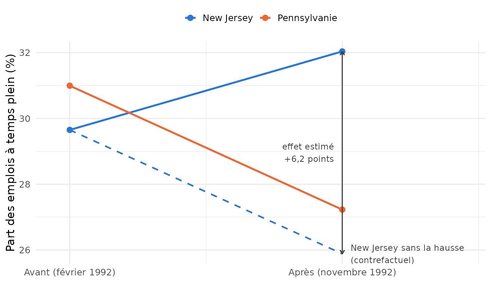

## Déroulé

| | Bloc | Durée |
|:--|:--|:--|
| 1 | Modéliser à l'ère de l'IA : trois tâches | 10 min |
| 2 | Cinq questions causales tirées de nos recherches | 10 min |
| 3 | Le contrefactuel et le biais de sélection | 15 min |
| 4 | L'expérience, vraie ou naturelle | 10 min |
| 5 | Données d'enquête : confusion, médiation, collision | 15 min |
| 6 | La régression : comparer à caractéristiques égales | 15 min |
| 7 | Stratégies d'identification : ce que font nos articles | 10 min |
| 8 | Valider, et ouvrir sur les nouvelles sources | 5 min |

::: {.notes}
11 h – 12 h 30, après le cours de Fabrice sur les populations synthétiques. Fil rouge : toute la séance part des questions causales de cinq articles, pour arriver aux modèles. Le labo reprend chaque étape sur données réelles : deux expériences, puis l'EDS du Ghana 2003 de l'article de 2013.
:::

# 1 · Modéliser à l'ère de l'IA

## Trois tâches, trois questions

| Tâche | Question | Exemple pour un INS |
|:--|:--|:--|
| **Décrire** | Quoi ? Combien ? Où ? | Quelle part des accouchements est assistée, par région ? |
| **Prédire** | Qui ? Quand ? | Quelles femmes risquent d'accoucher sans assistance ? |
| **Expliquer** | Pourquoi ? Et si… ? | Les consultations prénatales **augmentent-elles** l'accouchement assisté ? |

Hernán, Hsu et Healy (2019) : ces trois tâches n'appellent **ni les mêmes modèles, ni les mêmes variables**.

::: {.notes}
La plupart des publications des INS décrivent. Les décideurs posent pourtant des questions du troisième type : « si l'on rend les CPN gratuites, combien d'accouchements assistés de plus ? ». Le labo, partie D, montre qu'un modèle qui prédit mieux peut expliquer plus mal.
:::

## Et l'intelligence artificielle ?

- L'apprentissage automatique et les modèles de langage excellent à **prédire** : repérer des régularités dans d'énormes masses de données.
- Ils ne disent pas **pourquoi** : une corrélation apprise sur des millions de cas reste une corrélation.
- La causalité ne vient pas de la quantité de données, mais du **plan d'analyse** : une question contrefactuelle, une hypothèse d'identification, une théorie.

> Avec l'IA, calculer devient facile. Savoir **quelle comparaison** répond à **quelle question** devient la compétence rare.

# 2 · Cinq questions causales

## Nos questions de recherche

| Article | Question | Traitement → résultat |
|:--|:--|:--|
| Adjiwanou et LeGrand (2013) | Les CPN favorisent-elles l'accouchement assisté ? | CPN → accouchement assisté |
| Adjiwanou, Bougma et LeGrand (2018) | L'éducation du conjoint améliore-t-elle la santé des femmes ? | Éducation du conjoint → contraception, CPN, accouchement |
| Adjiwanou et N'Bouke (2015) | Pourquoi violence conjugale et contraception vont-elles de pair ? | Violence ↔ contraception |
| Adjiwanou, Boco et Yaya (2021) | Vivre avec un beau-père réduit-il la scolarisation ? | Beau-père → fréquentation scolaire |
| John et Adjiwanou (2021) | Le remariage freine-t-il la fécondité ? | Remariage → nombre d'enfants |

Toutes posent la même question de fond : **que se serait-il passé autrement ?**

::: {.notes}
Toutes utilisent des EDS : aucune expérience possible. Chacune a dû affronter un problème différent : confusion, sens de la causalité, sélection, inobservé. Ce sont ces problèmes qui organisent la suite du cours.
:::

# 3 · Le contrefactuel

## Deux résultats potentiels pour chaque personne

Pour une femme $i$ et un traitement $D_i$ (au moins 4 CPN = 1, sinon 0) :

- $Y_i(1)$ : accouche-t-elle avec assistance **si** elle a fait 4 CPN ?
- $Y_i(0)$ : accouche-t-elle avec assistance **si** elle ne les a pas faites ?
- L'**effet causal** pour elle : $Y_i(1) - Y_i(0)$

| Femme | CPN | $Y_i(1)$ | $Y_i(0)$ | Effet |
|:--|:--:|:--:|:--:|:--:|
| Aminata | 1 | 1 | **?** | **?** |
| Fatou | 0 | **?** | 0 | **?** |

**Le problème fondamental de l'inférence causale** : on n'observe jamais les deux résultats pour la même personne.

## Le biais de sélection

$$
\begin{aligned}
\underbrace{E[Y \mid D=1] - E[Y \mid D=0]}_{\text{différence observée}}
&= \underbrace{E[Y(1) - Y(0) \mid D=1]}_{\text{effet sur les traitées}} \\
&+ \underbrace{E[Y(0) \mid D=1] - E[Y(0) \mid D=0]}_{\text{biais de sélection}}
\end{aligned}
$$

- Les femmes qui font 4 CPN sont plus instruites, plus riches, plus proches d'un centre de santé.
- **Même sans CPN**, elles accoucheraient plus souvent avec assistance : le biais de sélection est **positif**.
- La différence observée **surestime** l'effet.

::: {.notes}
Dans le cours de méthodes, l'exemple d'Angrist et Pischke : les personnes hospitalisées se déclarent en moins bonne santé que les autres. L'hôpital ne rend pas malade : ce sont les malades qui vont à l'hôpital. Là, le biais de sélection est négatif et peut masquer complètement un effet positif.
:::

## Ce que donne la comparaison naïve

Dans les données du labo (EDS Ghana 2003, femmes rurales, n = 1 886) :

| | Accouchement assisté |
|:--|--:|
| Femmes avec au moins 4 CPN | 40 % |
| Femmes avec moins de 4 CPN | 12 % |
| **Différence observée** | **28 points** |

Combien de ces 28 points sont un **effet** des CPN, et combien un **biais de sélection** ? Avec de vraies données, personne ne connaît la réponse : tout le reste du cours sert à s'en approcher.

# 4 · L'expérience

## Le hasard résout le problème

- Si l'on tire au sort qui reçoit le traitement, les deux groupes sont **identiques en moyenne**, sur ce qu'on observe **et** sur ce qu'on n'observe pas.
- Le biais de sélection disparaît : l'effet est une **simple différence de moyennes**.

**Discrimination à l'embauche** (Bertrand et Mullainathan, 2004) : des CV identiques, un prénom tiré au sort.

| Prénom | Taux de rappel |
|:--|--:|
| À consonance blanche (Emily, Greg) | 9,7 % |
| À consonance afro-américaine (Lakisha, Jamal) | 6,4 % |
| **Effet** | **−3,2 points** |

::: {.notes}
Forces : validité interne. Limites : validité externe (Boston et Chicago en 2001), éthique, coût, et une explication causale faible (on sait que le prénom compte, pas pourquoi). En Afrique de l'Ouest, les expériences existent (transferts monétaires, gratuité, information), mais la plupart des questions démographiques ne se randomisent pas : on ne tire pas au sort un mariage ou un beau-père.
:::

## L'expérience naturelle : la double différence

:::: {.columns}
::: {.column width="62%"}

:::
::: {.column width="38%"}
**Card et Krueger (1994)** : le New Jersey relève son salaire minimum, pas la Pennsylvanie.

- Après seulement : +4,8 points
- Avant-après : +2,4
- **Double différence : +6,2**

Hypothèse : **tendances parallèles**.
:::
::::

::: {.notes}
Chaque estimation repose sur une hypothèse différente : comparabilité des États, absence de changement dans le temps, tendances parallèles. La double différence est la plus crédible des trois. Transposition UEMOA : une politique appliquée dans certaines régions et pas d'autres (gratuité des soins, cantines scolaires).
:::

# 5 · Données d'enquête : les graphes causaux

## Trois conditions pour parler de cause

1. **Antériorité** : la cause précède l'effet.
2. **Association** : la cause et l'effet varient ensemble.
3. **Isolement** : aucune autre explication plausible de cette association.

Avec des données d'enquête, la troisième condition est toujours la plus difficile. Les **graphes causaux** (DAG) obligent à dire quelles autres explications on envisage.

## La confusion : contrôler

```{dot}
//| fig-width: 8
//| fig-height: 2.6
digraph G {
  rankdir=LR; bgcolor="transparent";
  node [shape=box, style="rounded,filled", fillcolor="#f2f1ec", color="#9a9890", fontname="Helvetica", fontsize=16];
  edge [color="#3d3d3a", penwidth=1.6];
  E [label="Instruction, richesse,\ndistance, milieu"];
  D [label="CPN", fillcolor="#d6e6f7"];
  Y [label="Accouchement assisté", fillcolor="#d6e6f7"];
  E -> D; E -> Y; D -> Y;
}
```

Un **facteur de confusion** influence à la fois le traitement et le résultat. Il faut le **contrôler** : comparer des femmes de même instruction, même richesse, même distance.

## La médiation : ne pas contrôler

```{dot}
//| fig-width: 8
//| fig-height: 2.2
digraph G {
  rankdir=LR; bgcolor="transparent";
  node [shape=box, style="rounded,filled", fillcolor="#f2f1ec", color="#9a9890", fontname="Helvetica", fontsize=16];
  edge [color="#3d3d3a", penwidth=1.6];
  D [label="CPN", fillcolor="#d6e6f7"];
  M [label="Accouchement\nen centre de santé"];
  Y [label="Accouchement assisté", fillcolor="#d6e6f7"];
  D -> M -> Y; D -> Y;
}
```

Le lieu d'accouchement est une **conséquence** des CPN. Le contrôler retire le chemin principal de l'effet : dans le labo, l'estimation tombe de 22 à 2 points.

**Règle** : une variable de contrôle doit être mesurée **avant** le traitement.

## La collision : attention à l'échantillon

```{dot}
//| fig-width: 8
//| fig-height: 2.4
digraph G {
  rankdir=LR; bgcolor="transparent";
  node [shape=box, style="rounded,filled", fillcolor="#f2f1ec", color="#9a9890", fontname="Helvetica", fontsize=16];
  edge [color="#3d3d3a", penwidth=1.6];
  E [label="Instruction\nde la mère", fillcolor="#d6e6f7"];
  F [label="Accouchement\nen structure"];
  S [label="Enfant pesé\nà la naissance", fillcolor="#f7e0d6"];
  E -> S; F -> S;
}
```

Dans l'EDS de Tanzanie, près de la moitié des enfants n'ont pas été pesés. Étudier le poids **seulement chez les enfants pesés**, c'est sélectionner sur un **collisionneur** : on fausse l'association entre l'instruction de la mère et l'accouchement en structure, et donc toute analyse qui les relie au poids.

## Le sens de la flèche : la causalité inverse

**Adjiwanou et N'Bouke (2015)** : dans plusieurs pays d'Afrique subsaharienne, les femmes victimes de violence conjugale utilisent **plus** la contraception. Un paradoxe ?

- **Violence → contraception** : se protéger d'une grossesse dans une relation violente.
- **Contraception → violence** : la sanction d'une décision prise sans l'accord du conjoint.
- Un **troisième facteur** : l'autonomie des femmes, qui accroît à la fois le recours à la contraception et les conflits.

Une enquête transversale mesure les deux en même temps : **l'antériorité n'est pas garantie**.

## Ce que montre l'article

EDS de 13 pays (2006-2011), femmes en union non stérilisées.

| Méthode | Effet de la violence sur la contraception moderne |
|:--|:--|
| Probit simple | Positif dans **5 pays** sur 13 (Burkina Faso, Mali, Nigeria, Tanzanie, Zimbabwe) |
| + autonomie des femmes | **Inchangé** : l'autonomie n'explique pas le paradoxe |
| Probit bivarié récursif (instruments : alcool du conjoint, violence du père, acceptation de la violence) | Significatif dans **aucun** pays |
| Appariement sur score de propension, bornes de Rosenbaum | Seul le **Burkina Faso** garde un effet robuste (+6 points) |

Le paradoxe venait surtout d'une **mauvaise spécification** : on traitait comme une cause une variable déterminée en même temps que le résultat.

::: {.notes}
Message général : quand la flèche peut aller dans les deux sens, aucun contrôle supplémentaire ne règle le problème. Il faut des données datées (calendrier des EDS), longitudinales, ou un modèle qui traite la simultanéité, ici le probit bivarié récursif. Mais ce modèle repose sur des instruments : l'alcool du conjoint ou la violence vue chez le père n'agiraient sur la contraception qu'à travers la violence. C'est une hypothèse à discuter avec la salle. Le Burkina Faso, pays hôte, est le seul où l'effet résiste en partie : bonne question de recherche pour l'INSD.
:::

# 6 · La régression

## Comparer à caractéristiques égales

Dale et Krueger : l'université privée « paie »-t-elle ? Neuf étudiants fictifs, regroupés selon les écoles où ils ont postulé et été admis.

| Comparaison | Bonus du privé |
|:--|--:|
| Naïve : tous les étudiants | 19 500 $ |
| **À l'intérieur des groupes** de même candidature | **12 500 $** |

La régression est un **entremetteur automatisé** : une moyenne pondérée de comparaisons « pommes avec pommes ».

$$
Y_i = \alpha + \beta\, D_i + \gamma\, X_i + \varepsilon_i
$$

$\beta$ : l'effet du traitement, les contrôles $X_i$ étant **maintenus fixes**.

## Ce que l'on oublie se retrouve dans β

Si le vrai modèle contient une variable $Z$ omise :

$$
\hat\beta_{\text{sans } Z} = \beta + \underbrace{\delta \times \gamma_Z}_{\text{biais de variable omise}}
$$

- $\gamma_Z$ : l'effet de $Z$ sur le résultat ;
- $\delta$ : l'association entre $Z$ et le traitement.

Le biais est nul seulement si $Z$ **n'influence pas le résultat** ou **n'est pas liée au traitement**. C'est la traduction algébrique de la confusion.

## Un résultat binaire : la régression logistique

$$
\log \frac{P(Y_i = 1)}{1 - P(Y_i = 1)} = \alpha + \beta\, D_i + \gamma\, X_i
$$

| Dans le labo (Ghana 2003) | Sans contrôle | Avec contrôles |
|:--|--:|--:|
| Rapport de cotes des CPN | 4,9 | 4,2 |
| **Effet en points de pourcentage** | **28** | **22** |

- Un rapport de cotes de 4,2 ne veut **pas** dire « 4,2 fois plus de chances ».
- Pour un décideur : prédire pour chaque femme la probabilité **avec** et **sans** CPN, puis faire la moyenne des différences. C'est le **contrefactuel par le modèle**.

## L'effet varie : les interactions

**Adjiwanou, Bougma et LeGrand (2018)** : 37 EDS d'Afrique subsaharienne et d'Asie, régressions logistiques multiniveaux.

- Par rapport aux femmes dont le conjoint est sans instruction, celles dont le conjoint a dépassé le secondaire ont environ **43 %** plus de chances d'avoir au moins 4 CPN, et **55 %** plus de chances d'accoucher avec du personnel qualifié.
- Mais l'effet d'une année d'études du conjoint **dépend de l'instruction de la femme** : pour la contraception, il est positif quand elle est peu instruite et **négatif** quand elle est instruite.

Une interaction ($D \times X$) répond à la question : **pour qui** l'effet est-il le plus fort ?

# 7 · Stratégies d'identification

## Ce que font nos articles

| Stratégie | Hypothèse | Article |
|:--|:--|:--|
| Contrôles, modèle multiniveau | Pas de confusion **non observée** | Adjiwanou, Bougma et LeGrand (2018) |
| **Effets fixes** de grappe, puis de mère | L'inobservé est **commun** à la grappe ou à la famille | Adjiwanou, Boco et Yaya (2021) |
| Correction de l'**endogénéité** (équations structurelles) | Le modèle décrit correctement la sélection dans le traitement | Adjiwanou et LeGrand (2013) |
| **Double différence** | Tendances parallèles | Card et Krueger (1994) |
| **Probit bivarié** avec instruments ; score de propension et bornes de Rosenbaum | Instruments valides ; force d'un facteur caché | Adjiwanou et N'Bouke (2015) |

**Aucune méthode ne supprime toutes les hypothèses** : chacune déplace la question vers une hypothèse qu'il faut défendre.

## Exemple : les effets fixes

**Adjiwanou, Boco et Yaya (2021)** : 277 726 enfants de 6 à 14 ans, 33 EDS (2006-2015).

| Comparaison | Rapport de cotes de la fréquentation scolaire, beau-père vs deux parents |
|:--|--:|
| Effets fixes de **grappe** | 0,76 |
| Effets fixes de **mère** (frères et sœurs comparés entre eux) | 0,49 |

- Les effets fixes neutralisent tout ce qui est commun à la grappe (école, normes, pauvreté locale), **même non mesuré**.
- Le lien est plus fort en ville et chez les 10-14 ans.
- Les auteurs restent prudents : données transversales, sélection possible des enfants (confiage), sous-échantillon restreint pour les effets fixes de mère.

## Exemple : l'endogénéité et la sélection

**Adjiwanou et LeGrand (2013)** : Ghana, Kenya, Ouganda, Tanzanie, milieu rural.

- Les femmes qui font des CPN diffèrent par des caractéristiques **non observées** (préférences, accès) qui jouent aussi sur l'accouchement.
- Un modèle d'**équations structurelles** qui corrige cette endogénéité montre que les probit et logit simples **sous-estiment** l'effet direct des CPN, qui passe en partie par les services reçus pendant les consultations.

**John et Adjiwanou (2021)** : 34 pays, femmes de 40 à 49 ans. Dans 29 pays, les femmes remariées finissent avec **moins** d'enfants que celles restées dans leur première union. Mais **qui se remarie** ? Le divorce et le remariage ne sont pas tirés au sort : la sélection fait partie de la question.

::: {.notes}
Point pédagogique : le sens du biais n'est pas toujours celui qu'on attend. Dans l'article de 2013, la correction augmente l'effet estimé ; dans le labo (Ghana), la variable instrumentale donne aussi un effet un peu plus élevé (28 points contre 22), alors que les effets fixes de grappe le réduisent (18). Il faut raisonner sur le mécanisme de sélection propre à chaque question, pas appliquer une règle.
:::

# 8 · Valider et ouvrir

## Valider un modèle : deux sens différents

| Pour **prédire** | Pour **expliquer** |
|:--|:--|
| Tester sur des données **non utilisées** pour l'estimation | Défendre les **hypothèses d'identification** |
| Éviter le **sur-ajustement** | Vérifier l'**équilibre** des groupes comparés |
| Validation croisée | Analyses de **sensibilité** : quelle force devrait avoir un facteur caché pour annuler le résultat ? |

Les **nouvelles sources** (téléphonie, réseaux sociaux, images satellitaires) multiplient les possibilités de prédire. Pour expliquer, elles servent surtout quand elles créent des **expériences naturelles** ou des données **longitudinales** (Salganik, 2018, chapitre 4).

## À retenir

1. Distinguer **décrire, prédire, expliquer** avant de choisir un modèle.
2. Une question causale est une question **contrefactuelle** : que se serait-il passé autrement ?
3. La comparaison naïve mélange l'effet et le **biais de sélection**.
4. **Contrôler les facteurs de confusion, pas les médiateurs** ; se méfier des échantillons sélectionnés.
5. Toute stratégie (contrôles, effets fixes, double différence, instruments) repose sur une **hypothèse à défendre**.
6. Présenter les effets en **points de pourcentage**, pas seulement en rapports de cotes.

## Question de sortie

> Choisissez une question de votre note pays. Est-ce une question de description, de prédiction ou d'explication ? Si c'est une question causale, quel est le principal facteur de confusion, et quelle stratégie permettrait de l'écarter ?

**Cet après-midi**, le labo reprend chaque étape : l'expérience des CV, la double différence du salaire minimum, puis l'EDS du Ghana de l'article de 2013, où l'on voit l'estimation bouger d'une méthode à l'autre.

## Références {.smaller .scrollable}

- Adjiwanou, V. et LeGrand, T. (2013). Does antenatal care matter in the use of skilled birth attendance in rural Africa: A multi-country analysis. *Social Science & Medicine*, 86, 26-34.
- Adjiwanou, V. et N'Bouke, A. (2015). Exploring the paradox of intimate partner violence and increased contraceptive use in sub-Saharan Africa. *Studies in Family Planning*, 46(2), 127-142.
- Adjiwanou, V., Bougma, M. et LeGrand, T. (2018). The effect of partners' education on women's reproductive and maternal health in developing countries. *Social Science & Medicine*, 197, 104-115.
- Adjiwanou, V., Boco, G. A. et Yaya, S. (2021). Stepfather families and children's schooling in sub-Saharan Africa: A cross-national study. *Demographic Research*, 44(27), 627-670.
- Angrist, J. D. et Pischke, J.-S. (2015). *Mastering 'Metrics: The Path from Cause to Effect*. Princeton University Press.
- Bertrand, M. et Mullainathan, S. (2004). Are Emily and Greg more employable than Lakisha and Jamal? *American Economic Review*, 94(4), 991-1013.
- Card, D. et Krueger, A. B. (1994). Minimum wages and employment. *American Economic Review*, 84(4), 772-793.
- Cunningham, S. (2021). *Causal Inference: The Mixtape*. Yale University Press (mixtape.scunning.com).
- Dale, S. B. et Krueger, A. B. (2002). Estimating the payoff to attending a more selective college. *Quarterly Journal of Economics*, 117(4), 1491-1527.
- Hernán, M. A., Hsu, J. et Healy, B. (2019). A second chance to get causal inference right: A classification of data science tasks. *Chance*, 32(1), 42-49.
- Imai, K. (2017). *Quantitative Social Science: An Introduction*. Princeton University Press.
- John, B. M. et Adjiwanou, V. (2022). Fertility decline in sub-Saharan Africa: Does remarriage matter? *Population Studies*, 76(2), 213-233.
- Salganik, M. J. (2018). *Bit by Bit: Social Research in the Digital Age*. Princeton University Press (bitbybitbook.com).
