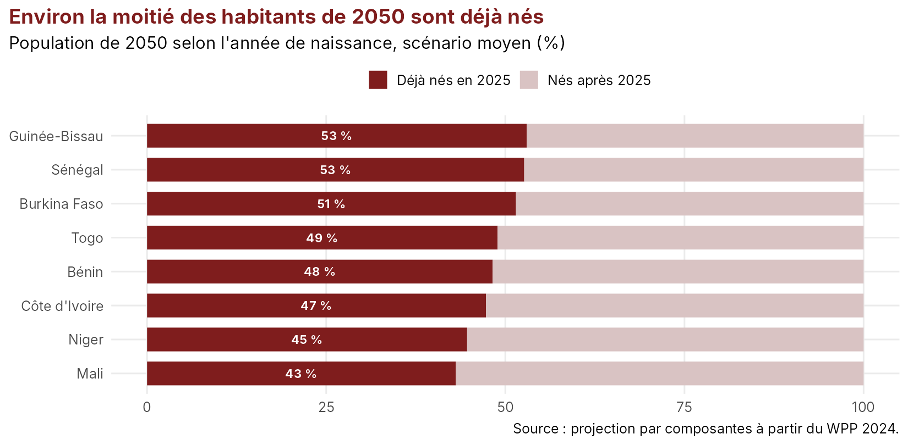
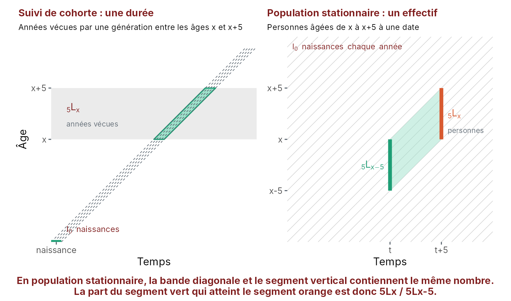
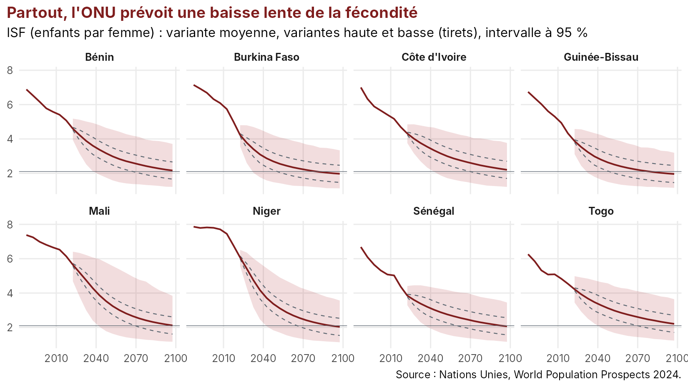
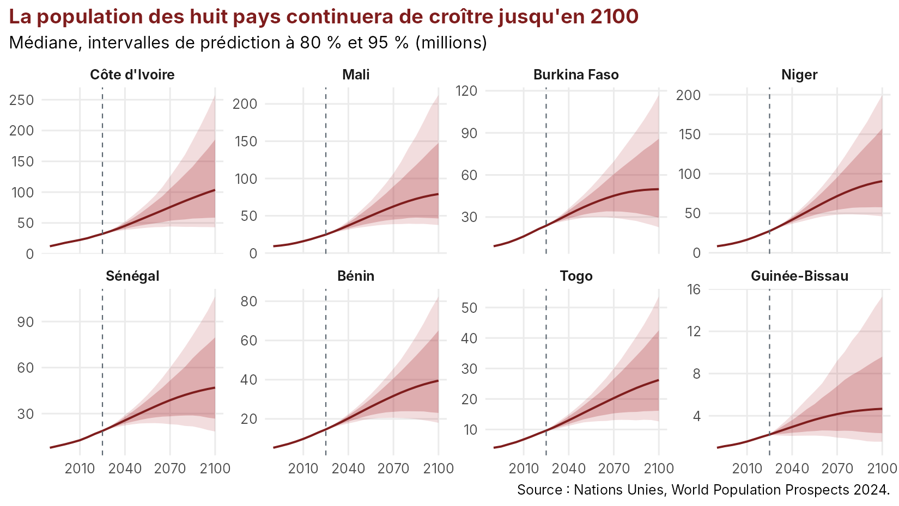
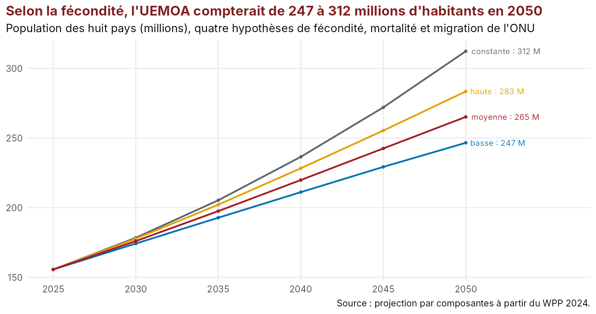
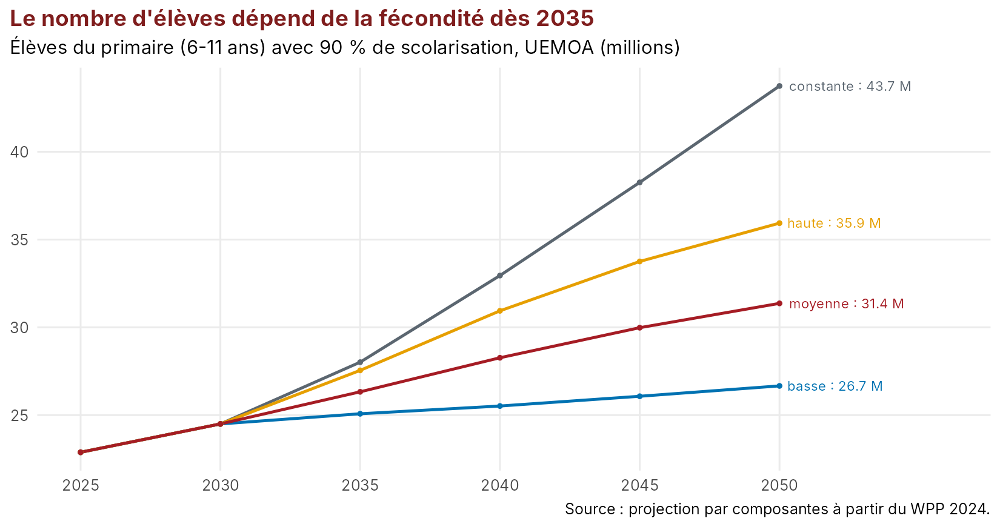
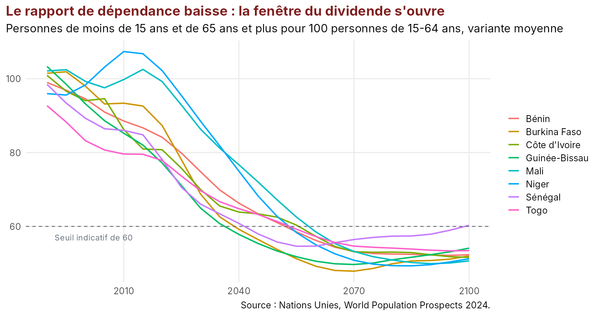
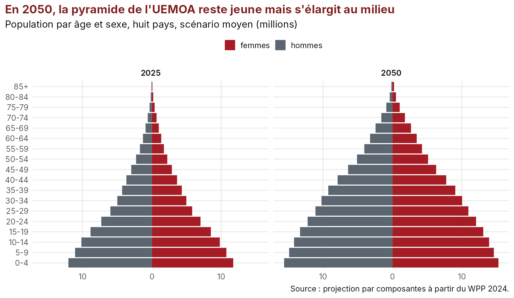

## Déroulé de la journée

| Horaire | Bloc | Contenu |
|:--|:--|:--|
| 8 h 30 – 9 h | Retour sur l'exercice de mercredi | Deux équipes présentent |
| 9 h – 12 h 30 | **Cours** (pause 10 h 30 – 11 h) | Méthodes, hypothèses, incertitude, besoins |
| 14 h – 15 h 30 | **Labo** (démonstration) | Projeter un pays à 2050 en R, et en Excel |
| 15 h 45 – 17 h 45 | **Travail en équipe pays** | Scénario à 2050 et besoins d'un secteur |

::: {.notes}
Annoncer le livrable de la journée dès maintenant : à 17 h 45, chaque équipe a une projection de son pays à 2050 sous quatre hypothèses, comparée à l'ONU, et un chiffre de besoins pour un secteur. C'est la section « Scénario à 2050 » de la note pays.
:::

## Objectifs de la journée

À la fin de la journée, vous serez capables de :

1. **expliquer** la méthode des composantes et ce que chaque hypothèse y apporte ;
2. **projeter** la population de votre pays à 2050 sous plusieurs hypothèses de fécondité, en R ou en Excel ;
3. **lire** une projection probabiliste et dire ce qu'elle permet d'affirmer ;
4. **traduire** une projection en besoins pour un secteur (écoles, emplois, santé) et l'écrire en une phrase pour un décideur.

## Plan du cours

| | Partie | Durée |
|:--|:--|:--|
| 1 | Pourquoi projeter ? | 20 min |
| 2 | Des formules globales à la méthode des composantes | 25 min |
| 3 | La méthode des composantes, pas à pas | 45 min |
| | *Pause* | *30 min* |
| 4 | Construire les hypothèses | 35 min |
| 5 | L'incertitude : des variantes aux projections probabilistes | 25 min |
| 6 | Des projections aux besoins, et au-delà | 30 min |

::: {.notes}
3 heures de contenu hors pause. Les parties 3 et 4 sont le cœur : ne pas les sacrifier si la partie 1 déborde.
:::

## Sondage d'ouverture

Levez la main :

1. Votre INS a-t-il publié une projection de population depuis le dernier recensement ?
2. Avez-vous déjà **participé** à une projection ? Avec quel outil : Excel, Spectrum, R, autre ?
3. Avez-vous déjà utilisé **R** au-delà des labos de cette semaine ?

::: {.notes}
Ce sondage décide de l'organisation du labo de l'après-midi. Si plus de la moitié de la salle n'est pas à l'aise en R, faire la démonstration en R, puis donner la main sur le classeur Excel pour le travail en équipe. Noter au tableau le nombre de mains pour chaque question.
:::

# 1 · Pourquoi projeter ?

## « Gouverner, c'est prévoir »

> « Savoir pour prévoir, prévoir pour agir. » — Jacques Vallin (2002)

> « Les perspectives démographiques servent à nous faire connaître par le calcul quel serait l'avenir d'une population, en nombre et en structure, dans telle ou telle hypothèse. » — Louis Henry (1973)

- Anticiper les conséquences de tendances déjà engagées.
- Éviter qu'un futur porteur de déséquilibres ne se réalise : c'est le paradoxe de la projection réussie, qui ne se réalise pas parce qu'on a agi.

::: {.notes}
Catherine Rollet résume l'ambivalence : on projette pour prévoir, mais parfois aussi « pour ne pas voir », quand les chiffres servent à justifier une décision déjà prise.
:::

## Trois mots à ne pas confondre

| Terme | Ce que c'est | Question posée |
|:--|:--|:--|
| **Projection** | Calcul conditionnel : résultat mécanique d'hypothèses données | « Que se passerait-il si… ? » |
| **Perspective** | Projection jugée la plus plausible par son auteur | « Que pensons-nous probable ? » |
| **Prévision** | Projection assortie d'une mesure explicite d'incertitude | « Avec quelle probabilité ? » |

Une projection ne se trompe jamais : elle est juste, si le calcul l'est, au regard de ses hypothèses. Ce sont **les hypothèses** qui peuvent se tromper.

## À quoi servent les projections dans un INS ?

:::: {.columns}
::: {.column width="50%"}
### Planification
- Plans nationaux de développement
- Cartes scolaires, besoins en enseignants
- Couverture vaccinale, soins maternels
- Emplois à créer, retraites
:::
::: {.column width="50%"}
### Statistique publique
- Dénominateurs des indicateurs (ODD, taux de scolarisation, couverture sanitaire)
- Bases de sondage des enquêtes entre deux recensements
- Allocation de budgets aux régions
:::
::::

**À la salle :** quels ministères vous demandent des projections ? À quel niveau géographique ?

::: {.notes}
Laisser 4 à 5 minutes. Faire ressortir que la demande est surtout infranationale (régions, communes) et sectorielle, alors que les projections publiées sont souvent nationales.
:::

# 2 · Des formules globales à la méthode des composantes

## Malthus (1798) : la première projection célèbre

> « La population croît à un rythme géométrique alors que les subsistances évoluent de manière linéaire. »

:::: {.columns}
::: {.column width="55%"}
- Population : 1, 2, 4, 8, 16, 32…
- Subsistances : 1, 2, 3, 4, 5, 6…
- D'où les « freins » : préventifs (mariage tardif) ou destructifs (famines, épidémies).
:::
::: {.column width="45%"}
- Marx répond que la « surpopulation » est relative à un mode de production.
- Boserup inverse la causalité : la pression démographique stimule l'innovation agricole.
:::
::::

::: {.notes}
La méthode de Malthus, une seule courbe pour toute la population, a été abandonnée. Le débat population-ressources revient aujourd'hui avec le climat (dernière partie du cours). Ce qui a été abandonné, c'est la projection par une seule courbe globale.
:::

## Les méthodes mathématiques globales

| Modèle | Formule | Hypothèse implicite |
|:--|:--|:--|
| Linéaire | $P(t) = P(0) + b\,t$ | Même accroissement absolu chaque année |
| Géométrique | $P(t) = P(0)\,(1+r)^t$ | Taux de croissance constant, discret |
| Exponentielle | $P(t) = P(0)\,e^{rt}$ | Taux de croissance constant, continu |
| Logistique | $P(t) = \dfrac{K}{1 + e^{-r(t - t_0)}}$ | Croissance freinée vers un plafond $K$ |

Avec $r = \ln\!\big(P(t_2)/P(t_1)\big) / (t_2 - t_1)$ entre deux recensements.

**Limites :** aucune structure par âge, donc pas d'élèves, pas d'actifs, pas de naissances ; un taux constant ignore la transition.

::: {.notes}
Elles restent utiles pour interpoler entre deux recensements, pour estimer une population à une date intermédiaire, ou pour de très petites zones sans données par âge. L'exercice 1 du travail en équipe compare une projection exponentielle à la projection par composantes.
:::

## Pourquoi raisonner par âge : l'inertie démographique



::: {.notes}
Message clé : à horizon 2050, environ la moitié de la population est déjà née. Leur nombre ne dépend plus que de la mortalité et de la migration. C'est pourquoi les projections à 20 ou 25 ans sont robustes pour les adultes, et incertaines surtout pour les enfants.
:::

## La méthode des composantes

- Utilise les trois phénomènes de la dynamique : **fécondité, mortalité, migration**.
- Appliquée pour la première fois par **Wicksell (1926)** et **Whelpton (1928)**.
- Base de toutes les projections modernes : ONU, Wittgenstein Centre, IHME, INS.

L'équation de bilan, appliquée à chaque groupe d'âge et de sexe :

$$
P_{t+5} = P_t + \underbrace{N_{t,t+5}}_{\text{naissances}} - \underbrace{D_{t,t+5}}_{\text{décès}} + \underbrace{I_{t,t+5} - E_{t,t+5}}_{\text{migration nette}}
$$

# 3 · La méthode des composantes, pas à pas

## Les intrants

| Intrant | Ventilation | Source (dans le labo) |
|:--|:--|:--|
| Population de départ, 1er juillet 2025 | sexe × âge quinquennal, 0-4 à 100+ | WPP 2024 ou recensement corrigé |
| Rapports de survie $_5L_x / {}_5L_{x-5}$ | sexe × âge × période | tables de mortalité projetées |
| Taux de fécondité par âge $f_x$ | 15-19 à 45-49 × période | ISF × calendrier |
| Rapport de masculinité à la naissance | période | 1,03 à 1,05 dans l'UEMOA |
| Migrants nets $M_x$ | sexe × âge × période | hypothèse de l'ONU |

## L'algorithme en un schéma

```{mermaid}
%%| fig-width: 11
flowchart LR
  A["Population en t<br/>sexe × âge"] --> B["1. Survie<br/>× ₅Lₓ / ₅Lₓ₋₅"]
  M["Migration nette<br/>moitié début, moitié fin"] --> B
  B --> C["2. Groupe ouvert<br/>95-99 et 100+ → 100+"]
  C --> D["Population en t+5"]
  A -->|"femmes 15-49"| E["3. Naissances<br/>f(x) × femmes moyennes"]
  E --> F["4. Filles et garçons<br/>selon le RMN"]
  F --> G["5. Survie jusqu'à 0-4 ans"]
  G --> D
  D -.->|"période suivante"| A
```

On répète les étapes à chaque période de 5 ans : 2025 → 2030 → … → 2050.

## Deux lectures de $_5L_x$ sur le diagramme de Lexis

{fig-align="center" style="max-height: 76vh;"}

::: {.notes}
Même formule, ₅Lₓ = intégrale de l(x+u) pour u de 0 à 5, mais deux lectures.

À gauche, le suivi d'une cohorte : ₅Lₓ est une durée, le nombre d'années vécues par l₀ naissances entre les âges exacts x et x+5. On le lit le long d'une diagonale, dans la bande horizontale des âges x à x+5.

À droite, la population stationnaire (l₀ naissances chaque année, mortalité qui ne change jamais) : chaque génération vit la même histoire, donc le nombre de personnes âgées de x à x+5 à une date est égal au nombre d'années vécues par une génération entre ces âges. ₅Lₓ devient un effectif, lu sur un segment vertical.

C'est cette seconde lecture qu'utilise la projection : la part du segment vert qui atteint le segment orange cinq ans plus tard est ₅Lₓ / ₅Lₓ₋₅.

Si la question vient : ce rapport n'est pas égal à l(x)/l(x−5), qui est la survie d'une personne d'âge exact x−5 (la ligne de vie du bas du parallélogramme). C'est la moyenne des survies individuelles l(x+u)/l(x−5+u), pondérée par la répartition des personnes à l'intérieur du groupe, supposée proportionnelle à l(x−5+u). Avec ce poids, l(x−5+u) se simplifie et il reste ∫l(x+u)du / ∫l(x−5+u)du = ₅Lₓ/₅Lₓ₋₅.

Les ₅L de la projection viennent d'une table du moment (mortalité de 2025-2030) : on applique à de vraies personnes la survie d'une cohorte fictive.
:::

## Étape 1 : faire vieillir les cohortes

$$
{}_5N_x(t+5) = {}_5N_{x-5}(t) \cdot \frac{{}_5L_x}{{}_5L_{x-5}}
$$

- Formule de Preston, Heuveline et Guillot (2001, chap. 6). Le rapport vient de la table de mortalité de la période ; dans le code du labo, il s'appelle `S`.
- **Exemple** : 515 562 filles de 15-19 ans au Togo en 2025, $_5L_{20} / {}_5L_{15} = 0{,}985$ → environ 508 000 femmes de 20-24 ans en 2030, avant migration.
- **Groupe ouvert** : même principe, avec le rapport $T_{100} / T_{95}$ appliqué aux 95-99 ans et aux 100 ans et plus.

::: {.notes}
Le chiffre de 515 562 vient du fichier pop_age_sexe.csv (Togo, 2025, femmes, 15-19 ans, en milliers : 515,562). Le rapport 0,9853 est celui que calcule la fonction table_mortalite() du labo pour les femmes, période 2025-2030.
:::

## Étapes 2 à 4 : les naissances

On applique les taux de fécondité à l'effectif féminin **moyen** de la période :

$$
B(t, t+5) = 5 \sum_{x=15}^{45} f_x \cdot \frac{W_x(t) + W_x(t+5)}{2}
$$

On répartit par sexe, $B_F = B / (1 + \text{RMN})$ et $B_M = B - B_F$, puis on fait survivre les naissances jusqu'au groupe 0-4 ans :

$$
P_{0\text{-}4}(t+5) = B_s \cdot \frac{{}_5L_0}{5\, l_0}
$$

## Étape 5 : la migration

Hypothèse classique : la moitié des migrants arrive en début de période et subit la mortalité, l'autre moitié en fin de période.

$$
{}_5N_x(t+5) = \Big[{}_5N_{x-5}(t) + \tfrac{1}{2} M_x\Big] \frac{{}_5L_x}{{}_5L_{x-5}} + \tfrac{1}{2} M_x
$$

- Dans l'UEMOA, les soldes sont **négatifs** pour sept pays sur huit : de –13 000 (Guinée-Bissau) à –278 000 (Mali) sur 2025-2030.
- La Côte d'Ivoire est le seul pays à solde positif (+34 000).
- Ces soldes sont les plus incertains de toutes les hypothèses.

## Exemple chiffré à faire en binôme

| Groupe | Femmes en 2025 | $f_x$ annuel | Survie au groupe suivant |
|:--|--:|--:|--:|
| 15-19 | 120 000 | 0,10 | 0,995 |
| 20-24 | 100 000 | 0,20 | 0,993 |
| 25-29 | — | 0,18 | — |

**Calculez** (5 minutes) :

1. les femmes de 20-24 ans et de 25-29 ans en 2030 ;
2. les naissances de la période dues à ces deux groupes ;
3. les filles de 0-4 ans en 2030, avec un RMN de 1,05 et $_5L_0 / (5\,l_0) = 0{,}93$.

::: {.notes}
Corrigé : (1) 119 400 et 99 300. (2) 15-19 : 5 × 120 000 × (0,10 + 0,995 × 0,20) / 2 = 89 700 ; 20-24 : 5 × 100 000 × (0,20 + 0,993 × 0,18) / 2 = 94 685 ; total 184 385. (3) 184 385 × 0,4878 × 0,93 = 83 647 filles.
Faire remarquer que les femmes de 15-19 ans contribuent deux fois : à 15-19 ans en début de période et à 20-24 ans en fin de période.
:::

## Une projection ne vaut pas mieux que sa population de départ

- **Sous-dénombrement** des jeunes enfants et des jeunes hommes mobiles.
- **Attraction des âges ronds** : à mesurer par les indices de Whipple et de Myers, ou l'indice combiné des Nations Unies.
- **Date de référence** : ramener le recensement au 1er juillet de l'année de départ.

Deux choix possibles dans le labo :

1. la population de départ de l'**ONU**, déjà corrigée ;
2. **votre recensement** par âge simple, regroupé en âges quinquennaux et lissé, si vous l'avez apporté.

::: {.notes}
Cette question a été traitée en partie le lundi. Ne pas y passer plus de 5 minutes. Insister : si l'équipe utilise son recensement, l'écart avec l'ONU en 2050 viendra d'abord de la population de départ.
:::

# Pause · reprise à 11 h

# 4 · Construire les hypothèses

## Le choix des hypothèses

À chaque période, il faut choisir une table de mortalité, des taux de fécondité et des soldes migratoires.

1. **Constance** : fécondité et mortalité constantes. C'est un scénario de référence, pas une hypothèse plausible : il mène, à terme, au modèle de population stable.
2. **Extrapolation des tendances** : prolonger les séries passées les plus longues possibles. Limite : les retournements et les paliers.
3. **Analogie avec la transition** : s'inspirer d'un pays plus avancé dans la transition. Limite : quelle référence pour les pays qui ont fini leur transition ?
4. **Modèles statistiques** : trajectoires probabilistes de l'ONU (partie 5).

## Fécondité : le niveau

L'ONU distinguait trois groupes de pays : fécondité **élevée**, **moyenne** et **faible**. Aujourd'hui, chaque pays suit une trajectoire de baisse tirée d'un modèle commun à tous les pays.

Une forme simple et réaliste pour un scénario national, la logistique :

$$
\text{ISF}(t) = L + \frac{U - L}{1 + e^{\,k\,(t - t_0)}}
$$

$U$ = niveau de départ, $L$ = niveau final, $t_0$ = date de baisse la plus rapide, $k$ = vitesse.

**Variantes de l'ONU** : haute et basse = variante moyenne **± 0,5 enfant** (atteint progressivement).

## Fécondité : les hypothèses de l'ONU pour l'UEMOA



::: {.notes}
Lire un pays : Niger, 6,1 enfants par femme en 2020-2025, 3,4 en 2045-2050 dans la variante moyenne. Demander à la salle : cette baisse vous paraît-elle plausible dans votre pays ? Sur quoi fondez-vous votre jugement : EDS, MICS, recensement ?
:::

## Fécondité : le calendrier

Les taux par âge se déduisent de l'ISF et d'une structure par âge $p_x$ (somme égale à 1) :

$$
f_x = \frac{\text{ISF} \times p_x}{5}
$$

- Âge moyen à la maternité : $\bar m = \sum_x (x + 2{,}5)\,f_x \big/ \sum_x f_x$.
- Dans le labo, on garde le calendrier projeté par l'ONU et on ne fait varier que le **niveau**.
- Piège : un recul de l'âge à la maternité fait baisser l'ISF du moment sans changer la descendance finale (effet de calendrier).

## Mortalité

On projette l'**espérance de vie à la naissance** $e_0$, puis on en déduit une table complète.

- Gains rapides aux niveaux moyens, plus lents au-delà de 75 ans.
- L'ONU prévoit **+4 à +5,5 ans** dans l'UEMOA entre 2020-2025 et 2045-2050.
- De $e_0$ à une table : tables types, logit de Brass, Lee-Carter.

$$
Y_x = \tfrac{1}{2}\ln\!\left(\frac{1 - l_x}{l_x}\right) = \alpha + \beta\, Y_x^{\text{standard}}
$$

::: {.notes}
Pour les ordres de grandeur : Mali 60,0 → 65,0 ; Sénégal 68,1 → 73,4 ; Togo 62,3 → 67,0 (WPP 2024, deux sexes). La mortalité pèse peu sur la population totale à 2050 comparée à la fécondité, mais beaucoup sur le nombre de personnes âgées.
:::

## Migration

- On projette des **soldes nets** par âge et sexe, faute de flux d'entrées et de sorties mesurés.
- Profil par âge très régulier (modèle de Rogers-Castro) : un pic chez les jeunes adultes, les enfants qui suivent leurs parents.
- Hypothèses usuelles : solde constant, retour progressif vers zéro, scénarios (migration nulle ou doublée).
- Dans l'UEMOA, l'essentiel des migrations est **intrarégional** : ce que perd l'un, un voisin le gagne en partie.

::: {.notes}
Rappeler la limite des données : les entrées et sorties par âge et par sexe ne sont connues dans aucun pays de la région. Au mieux, on estime des soldes, souvent par la méthode résiduelle entre deux recensements.
:::

## Combiner les hypothèses : priorité à la fécondité

| Scénario | Fécondité | Mortalité | Migration |
|:--|:--|:--|:--|
| Constante | ISF de 2020-2025 maintenu | ONU, moyenne | ONU, moyenne |
| Haute | ONU, variante haute (+0,5) | ONU, moyenne | ONU, moyenne |
| **Moyenne** | **ONU, variante moyenne** | **ONU, moyenne** | **ONU, moyenne** |
| Basse | ONU, variante basse (–0,5) | ONU, moyenne | ONU, moyenne |

Ce sont les quatre scénarios du labo. À 2050, c'est la fécondité qui crée l'essentiel des écarts.

# 5 · L'incertitude : des variantes aux projections probabilistes

## Les projections de l'ONU sont-elles fiables ?

- On peut confronter les projections passées à ce qui s'est réalisé.
- La projection de la population mondiale de **l'an 2000**, faite en **1958**, s'est révélée remarquablement juste.
- Mais les erreurs croissent avec l'horizon, et elles sont plus fortes pour les pays dont les **données de base** sont fragiles.
- Les révisions successives changent les résultats : la population mondiale attendue en 2100 a été revue à la baisse d'environ 700 millions en dix ans.

## Des variantes aux probabilités

Les variantes ±0,5 enfant supposent un écart identique partout et toujours, ne disent rien de leur probabilité, et ignorent la mortalité et la migration.

Depuis le début des années 2010, l'ONU produit des **projections probabilistes** :

- un modèle bayésien de l'ISF et de $e_0$ pour chaque pays, dont les paramètres sont tirés d'une distribution commune à tous les pays ;
- des milliers de trajectoires, chacune passée dans la méthode des composantes ;
- depuis le WPP 2024, l'incertitude sur la **migration** est aussi intégrée.

## Lire une projection probabiliste



::: {.notes}
Lire la Côte d'Ivoire : médiane d'environ 100 millions en 2100, mais l'intervalle à 95 % va de 40 à plus de 250 millions. À horizon 2050, l'intervalle est étroit : c'est l'inertie. Une phrase prudente pour un décideur : « Il y a 95 chances sur 100 que la population soit comprise entre… et… ».
:::

## Trois règles pour utiliser ces résultats

1. **Une médiane n'est pas une certitude** : donnez toujours l'intervalle.
2. **Les quantiles ne s'additionnent pas.** Pour une région, un groupe d'âge ou un ratio, on calcule l'indicateur sur chaque trajectoire, puis on prend les quantiles.
3. **Variante moyenne ≠ médiane probabiliste.** La première est une projection déterministe, la seconde le milieu de milliers de trajectoires : elles diffèrent légèrement.

Dans le labo, vous disposerez des deux : la variante moyenne et les intervalles de l'ONU, et des simulations `bayesPop` déjà calculées pour les huit pays.

## Trois producteurs, trois logiques

| | ONU (WPP 2024) | Wittgenstein (2023) | IHME (GBD 2021) |
|:--|:--|:--|:--|
| Logique | Extrapolation statistique | L'éducation comme moteur | Régression sur des déterminants |
| Incertitude | Intervalles probabilistes | Scénarios SSP | Tirages et scénarios |
| Pic mondial | 10,3 milliards en 2084 | Selon le SSP | 9,7 milliards en 2064 (Vollset et al., 2020) |
| ISF mondial en 2100 | Environ 1,8 | Selon le SSP | 1,66 |

L'écart le plus fort concerne l'**Afrique subsaharienne** : la vitesse de baisse de la fécondité y dépend du modèle choisi plus que des données. Ezeh et al. (2020) soutiennent même que l'Afrique subsaharienne pourrait **dépasser** les projections, si la baisse de la fécondité y reste lente.

::: {.notes}
Message : pour planifier, la référence reste le WPP, avec ses intervalles. Le Wittgenstein Centre est utile dès que la question touche à l'éducation (les pyramides par niveau d'instruction vues lundi). L'IHME se lit comme une borne basse.
:::

# 6 · Des projections aux besoins, et au-delà

## Le scénario change le chiffre, pas la tendance



## Des projections dérivées : un même principe

$$
\text{Besoin}(x, t) = \text{taux}(x, t) \times P(x, t)
$$

| Secteur | Taux appliqué | Population | Résultat |
|:--|:--|:--|:--|
| Éducation | taux de scolarisation | 6-11 ans | élèves, enseignants, salles |
| Emploi | taux d'activité | 15-64 ans | actifs, emplois à créer par an |
| Santé | taux de recours | naissances, femmes 15-49 ans | accouchements, vaccinations |
| Logement | taux de chef de ménage | 15 ans et plus | ménages, logements |

## Exemple : les élèves du primaire



::: {.notes}
Avec 90 % de scolarisation et 45 élèves par maître, l'UEMOA passe d'environ 509 000 enseignants nécessaires en 2025 à près de 700 000 en 2050 dans le scénario moyen, et plus de 970 000 si la fécondité restait constante. L'écart entre scénarios, environ 380 000 enseignants entre la variante basse et la fécondité constante, est la vraie information pour le décideur.
:::

## Le dividende démographique



- La fenêtre s'ouvre quand le rapport de dépendance baisse : plus d'actifs potentiels par personne à charge.
- Elle ne produit un dividende que si ces actifs trouvent un **emploi** : c'est une opportunité, pas un acquis.

## La pyramide de l'UEMOA en 2050



## Population, ressources et climat

- **IPAT** (Ehrlich et Holdren, 1971) : $I = P \times A \times T$. L'impact dépend de la population, mais aussi de la consommation et des techniques.
- Par habitant, les pays à forte croissance démographique émettent peu : c'est le **paradoxe de la justice climatique** (Muttarak, 2024).
- Les scénarios **SSP** du GIEC reposent sur des projections démographiques par niveau d'instruction : la démographie est un intrant des politiques climatiques.
- Inversement, le climat agit sur la mortalité, la fécondité et la migration : les hypothèses de demain devront l'intégrer.

## De la projection agrégée à la microsimulation

| | Projection par composantes | Microsimulation |
|:--|:--|:--|
| Unité | Groupes d'âge et de sexe | Individus |
| Hétérogénéité | Moyennes par groupe | Caractéristiques individuelles (éducation, région, union) |
| Question | Combien ? | Pour qui ? Quelles inégalités ? |
| Données | Agrégats | Population synthétique, histoires de vie |

La microsimulation part d'une **population synthétique** (celle construite mercredi) et applique à chaque individu des risques d'événements. Elle permet de comparer l'évolution de deux groupes sous un même scénario.

## Ce qu'il faut retenir

1. Une projection est un **calcul conditionnel** : discutez les hypothèses, pas le calcul.
2. La méthode des composantes fait vieillir des cohortes déjà nées : à 2050, **environ la moitié** de la population est déjà là.
3. À cet horizon, la **fécondité** fait l'essentiel de l'écart entre scénarios.
4. Donnez toujours un **intervalle**, et n'additionnez jamais des quantiles.
5. Une projection ne sert la décision que traduite en **besoins** : élèves, enseignants, emplois, services.

## Vérification des acquis

1. Pourquoi les variantes haute et basse de l'ONU ne sont-elles pas des intervalles de confiance ?
2. Dans un pas de projection, pourquoi utilise-t-on l'effectif **moyen** des femmes de la période pour calculer les naissances ?
3. Votre ministre demande combien d'enseignants recruter d'ici 2035. Quelles hypothèses de la projection pèsent le plus sur votre réponse ?

## Cet après-midi

- **14 h – 15 h 30 · Labo** : projection de votre pays à 2050 en R (le script `tp1_projection.R`), puis la même chose dans le classeur Excel.
- **15 h 45 – 17 h 45 · Équipe pays** : choisir un scénario et un secteur, chiffrer l'écart de besoins entre deux scénarios, écrire la section « Scénario à 2050 » de la note pays.

Matériel : `projet-projection/` (données des huit pays, scripts, simulations, classeur Excel). Aucune connexion internet n'est nécessaire.

## Références {.smaller .scrollable}

::: {style="font-size: 0.85em"}
- Henry, L. (1973). *Perspectives démographiques*. INED.
- Preston, S. H., Heuveline, P. et Guillot, M. (2001). *Demography: Measuring and Modeling Population Processes*. Blackwell.
- Raftery, A. E. et al. (2012). Bayesian probabilistic population projections for all countries. *PNAS*, 109(35).
- Nations Unies (2024). *World Population Prospects 2024: Summary of Results*.
- K.C., S. et al. (2024). Updating the Shared Socioeconomic Pathways (SSPs) global population and human capital projections. IIASA, WP-24-003.
- Vollset, S. E. et al. (2020). Fertility, mortality, migration, and population scenarios for 195 countries and territories from 2017 to 2100. *The Lancet*, 396(10258), 1285-1306.
- Trovato, F. (2015). *Canada's Population in a Global Context*, 2e éd., chap. 11. Oxford University Press.
- Muttarak, R. (2024). Towards a better understanding of the role of population policies in tackling climate change. *Vienna Yearbook of Population Research*, 22, 45-51.
- Ezeh, A., Kissling, F. et Singer, P. (2020). Why sub-Saharan Africa might exceed its projected population size by 2100. *The Lancet*, 396(10258), 1131-1133.
- Ehrlich, P. R. et Holdren, J. P. (1971). Impact of population growth. *Science*, 171(3977), 1212-1217.
:::
